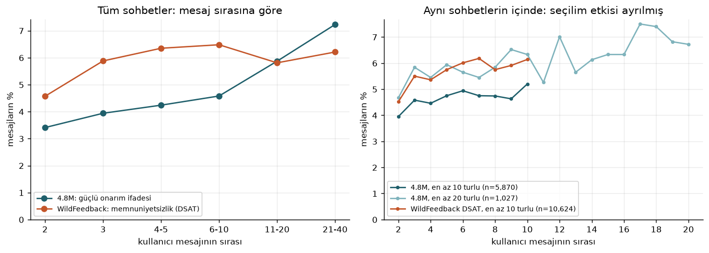
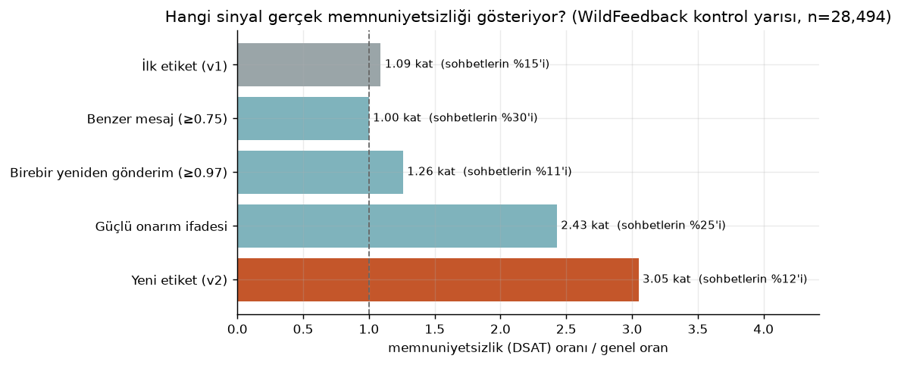
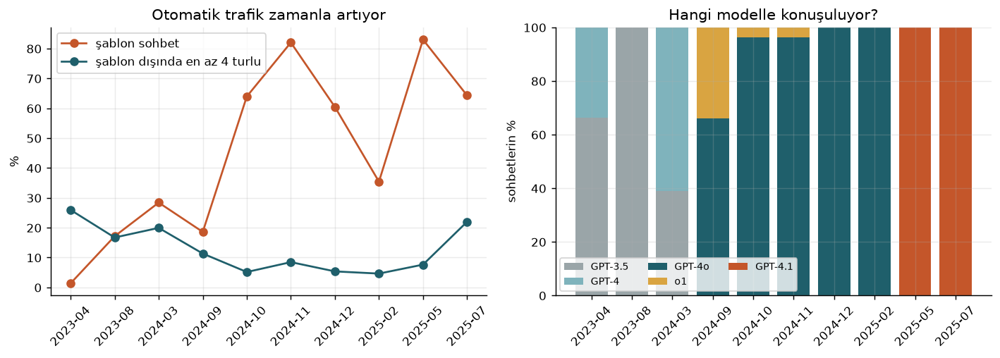
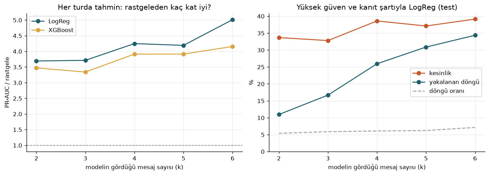

# Kâfi AI

### Üretken yapay zeka sohbetlerinde verimsiz döngülerin erken fark edilmesi

Samsung Innovation Campus Yapay Zeka programı 18. dönem bitirme projesi, Grup 1. Program UNDP Türkiye ve Yeşilay iş birliğiyle yürütülüyor; bu yılın teması **dijital bağımlılık**.

**Kısaca: ekran süresi değil, kısır döngü.**

> Ürünün adı **Kâfi AI**. Kodda kalan teknik adlar (`[KafiAI]` konsol öneki, `kafiai` Python paketi, depolama anahtarları) kullanıcı verisi kaybolmasın diye değişmedi.

---

## Proje hakkında

ChatGPT ve Gemini gibi yapay zeka asistanları ders çalışmanın ve iş yapmanın sıradan bir parçası oldu. Yoğun kullanımla birlikte bir alışkanlık da ortaya çıkıyor: aynı isteği tekrar tekrar göndermek, "olmadı, tekrar yaz" diye defalarca düzeltmeye çalışmak. Sohbet uzuyor, ilerleme duruyor.

Dijital iyi oluş araçları bunu göremiyor, çünkü yalnızca **süreyi** ölçüyorlar. İki saatlik verimli bir çalışma ile iki saat aynı yerde dönmek arasındaki fark sürede değil, **kullanım biçiminde**. Bu projede tek bir göstergeye odaklanıyoruz:

**Verimsiz döngü:** kullanıcının bir önceki cevabın işe yaramadığını tekrar tekrar söylediği ya da aynı isteği yeniden gönderdiği, uzayan ama sonuca ulaşmayan sohbet.

Projenin ilk taslağında ikinci bir gösterge olarak "aşırı güven ve düşünme devri" de vardı. Sohbet verisinden güvenilir biçimde ölçülemediği için kapsamdan çıkarıldı.

**Hedef grup:** Ders ve iş için üretken yapay zeka kullanan 18 ile 30 yaş arası yetişkinler.

---

## Ürün: Kâfi AI Chrome eklentisi

`extension/` klasöründe ChatGPT, Gemini, Claude, Copilot ve Google AI Modu'nun web arayüzünde çalışan bir Chrome eklentisi (Manifest V3, TypeScript) var. Sloganı "Fark et. Durakla. Yeniden başla." Hiçbir şeyi engellemez; her öneri tek tıkla geçilir. Ayrıntılı ürün anlatımı: [Bölüm 6](docs/06_product_scope.md).

| Özellik | Ne yapar | Ne zaman |
|---|---|---|
| **Halka** | Mesaj kutusunun köşesinde 18 piksellik sessiz gösterge. Döngü sinyalleri arttıkça aynı rengin tonu koyulaşır; kırmızı yok. Üzerine gelince neyi ölçtüğünü tek satırla söyler | Her zaman; üç seviye. İki temiz turdan sonra sakinleşir |
| **Benzer mesaj şeridi** | Mesaj gönderilmeden önce kısa bir şerit: "Neyin eksik olduğunu söyle" (hazır cümleler: "Biçim yanlış", "Bilgi yanlış", "Fazla uzun", "Fazla kısa"), "Yine de gönder"; üçüncü denemede "Yeni sohbete geç" | Mesaj birebir tekrarsa ya da öncekine çok benzeyip "olmadı" gibi bir onarım ifadesi taşıyorsa. Bilerek yapılan seri istekler ("başka bir slogan öner") ve yeni içerik getiren mesajlar şerit açmaz |
| **Kısa düzeltme şeridi** | "Olmadı", "yanlış" gibi kısa bir düzeltmede neyin olmadığını eklemeyi önerir: "Hata mesajını ekle", "Beklediğimi yaz" | 20 karakterden kısa onarım ifadesinde ("olmadi tekrar yap" dahil); ilk mesajda ve teklif sorusuna verilen yalın "hayır"da çıkmaz |
| **Kısa devam şeridi** | Üçüncü "devam"da yönü sorar: "Neyle devam etsin, yaz", "Nasıl devam etsin, yaz" | Üst üste üçüncü yönsüz devam isteğinde |
| **Çıkış kartı** | Cevap bittikten sonra çıkar, nedenini ve somut bir öneriyi söyler. "Taze başlat" istekleri tek bir taslakta toplar, panoya kopyalar ve yeni sohbet açar | Dört yoldan biriyle: tur modeli yüksek güvenle döngü tahmin etti; cevaplar üst üste iki kez özürle başladı; kullanıcı düzeltme istedi ama cevap öncekinin neredeyse aynısı; sohbet görev normunu aştı ve döngü işareti var. Anlam desteği açıksa iki yol daha: aynı istek ikinci kez soruldu ya da uzun bir düzeltme mesajında önceki cevap karşılamadı |
| **Taze başlat taslağı** | Benzer denemeler tek maddeye iner; konu değiştiyse yalnızca son konu girer; sohbette yeniden hatırlatılan kurallar ("söylemiştim, emoji kullanma") en başa konur; sonunda "Beklediğim sonuç:" ve "Önceki denemelerde olmayan kısım:" satırları | Karttan |
| **Yön sende** | Modelin teklif sorularına üst üste kısa onaylarda ("evet", "tamam") "Özetlet" ya da "Adımı ben yazayım" önerir | Üç kısa onaydan sonra, sohbet başına bir kez |
| **Araç çubuğu penceresi** | "Bu sohbet" özeti, son 7 günün içgörüleri, ayarlar (eklenti, öneriler, halka, çıkış kartı), "Sayaçlarımı kopyala", "Tüm verilerimi sil" | Her zaman |
| **Karşılama ekranı** | Neye baktığını, neye bakmadığını ve verinin nerede durduğunu söyler | İlk kurulumda ve "Kâfi AI nasıl çalışır?" bağlantısıyla |
| **Yalnızca say** | Öneriler kapalıyken hiçbir şey gösterilmez, yalnızca sayılır | Ayarlardan |
| **Anlam desteği** (isteğe bağlı) | Kelime kurallarının kaçırdığını anlamdan yakalar: başka sözcüklerle ya da başka dilde sorulan aynı istek, uzun bir düzeltme mesajı. Tur modelinin kartını da yalnızca bir sorun belirtisi görürse onaylar | Varsayılanı kapalı; kullanıcı açarsa her cevaptan sonra. Kişisel sohbette çalışmaz |

Kişisel ve duygusal sohbetlerde hiçbir öneri gösterilmez.

**Karar çekirdeği tek, siteler beş.** Tekrar, onarım ifadesi, görev türü, sohbet sinyalleri, tur modeli, halka ve kart kuralları `extension/src/core/` altında tek bir yerde durur ve beş sitede aynı çalışır. Siteye özel olan yalnızca sayfayı okuyan adaptörlerdir (`extension/src/adapters/`). Mesaj ancak sayfada gerçekten gönderildiği görülünce sayılır ve Enter ile sitenin kendi Gönder tıklaması tek gönderim sayılır; bu korumalar beş sitede ortak. Adaptörler temizlenmiş gerçek sayfa görüntüleriyle (`extension/test-snapshots/`) test edilir.

**Tur modeli.** Eklenti her yeni mesajda o ana kadarki kullanıcı mesajlarından 22 sayı hesaplar ve sohbetin döngüye girme olasılığını tahmin eder. Model 22 katsayılı, kalibre edilmiş bir lojistik regresyon; eklentide 1,7 KB'lık bir JSON dosyası ([`turn-model.json`](extension/src/data/turn-model.json)) olarak duruyor ve kütüphane kullanmadan çalışıyor. Python ile eklentinin aynı sohbete aynı sonucu verdiği parite testleriyle kontrol ediliyor. Ayrıntılar: [Bölüm 9](docs/09_turn_model.md).

### Gerçek memnuniyetsizliğe karşı isabet

Pilot yapılmadı; eklenti WildFeedback'teki 20.000 gerçek sohbet üzerinde tur tur yeniden oynatıldı ve kararları kullanıcının gerçekten memnuniyetsiz olduğu turlarla karşılaştırıldı (tüm turlarda memnuniyetsizlik %5,04). Kurallar bundan ayrık bir seçim örnekleminde seçildi. Kaynak: [`outputs/replay_eval.json`](outputs/replay_eval.json).

| Karar | 100 sohbette | İsabet |
|---|---|---|
| Benzer mesaj şeridi | 10,14 | %21,5 |
| Kısa düzeltme şeridi | 1,88 | %58,4 |
| Halka, koyu seviye | turların %9,4'ü | %29,9 |
| Çıkış kartı (tümü) | 23,77 | %30,2 |
| Çıkış kartı, düzeltme alınmadı | 0,97 | %50,0 |
| Çıkış kartı, özür döngüsü | 2,57 | %45,4 |
| Çıkış kartı, tur modeli | 20,02 | %27,5 |
| Çıkış kartı, uzun sohbet | 0,22 | %11,6 |

İsabet: şeritlerde o mesajda, halka ve kartta o turda ya da bir sonrakinde kullanıcının memnuniyetsiz olması. Kullanıcının iki ya da daha fazla kez memnuniyetsiz olduğu sohbetlerin %31,9'unda kart ikinci şikayetten önce geliyor.

Tüm turlarda memnuniyetsizlik %5,04 olduğu için bu isabetler tabanın 4 ile 12 katı: kısa düzeltme şeridi yaklaşık 11,6 kat, çıkış kartı 6,0 kat. Kart kapandıktan sonra döngü sürerse 3 tur sonra yeniden gelebilir (K53). Tek bir "doğruluk" yüzdesi verilmiyor; döngü turları azınlıkta olduğu için hiçbir şey göstermeyen bir sistem bile %95 doğru görünürdü.

**Anlam desteği açıkken** (K52; önbellekteki değerlendirici kararlarıyla, rapor örnekleminin ilk 2.000 sohbeti): kart isabeti %35,8, yakalama %31,1, isabetsiz kart 100 sohbette 11,05. Aynı alt kümede yalnızca kurallar %30,0 / %31,9 / 13,4. Bu karşılaştırma 5 turluk bekleme süresiyle yapıldı (K53 öncesi). Değerlendirici kararları eski istem ve Haiku ile; üründeki Sonnet ile yeniden ölçüm yapılmadı. Bu sayılar eklentinin her uyarıda haklı olmadığını da gösteriyor; bu yüzden hiçbir uyarı bir şeyi engellemez, hepsi tek tıkla geçilir ve "Yerinde değildi" ile işaretlenebilir.

**Sınırlar.** WildFeedback'in memnuniyetsizlik etiketi bir dil modeliyle üretildi ve çoğunlukla İngilizce; Türkçe kullanım için etiketli veri yok. Yeniden oynatma, kullanıcının bir öneriyi gördükten sonra davranışını değiştirip değiştirmediğini ölçmez. Kısa devam şeridi ve "Yön sende" önerisi bir döngü uyarısı değil, yön önerisi; eski veride seyrek oldukları için etkileri ölçülemedi. Gönderim korumaları ChatGPT'de canlı sitede, diğer dört sitede sayfa görüntüleriyle sınandı.

### Gizlilik

- Mesaj metni yalnızca sekmenin belleğinde durur; sekme kapanınca ya da sohbet değişince silinir. Cevabın yalnızca başı ve sonu, yalnızca bellekte ve yalnızca birkaç kural için okunur (özürle mi başladı, öncekinin aynısı mı, soruyla mı bitti).
- `chrome.storage` içinde yalnızca ayarlar ve günlük sayılar (90 gün) tutulur. Sayaç anahtarlarına metin, sohbet kimliği ya da adres giremez. Konsola metin değil, yalnızca `[KafiAI]` önekli sayı ve etiket yazılır.
- Varsayılan ayarlarla hiçbir mesaj cihazdan çıkmaz. Tek istisna kullanıcının açtığı **anlam desteği**dir: açıkken son turların kısa bir bölümü (kullanıcı mesajı en fazla 1.000, cevabın ilk 600 ve son 200 karakteri) Kâfi sunucusunda Claude ile değerlendirilir ve saklanmaz; kişisel sohbetlerde gönderilmez ([K51](docs/05_architecture_decisions.md), [gizlilik politikası](docs/PRIVACY.md)).
- Ağ isteği yapan tek kod arka plan çalışanındaki değerlendirici istemcisidir; depodaki ayarda sunucu adresi boştur ve adres boşken hiçbir istek gönderilmez. Eklenti sayfaları ve arka plan çalışanı için manifestte `connect-src 'none'` var (anlam desteğiyle derlenen pakette yalnızca o sunucuya izin verilir). İçerik betiği sohbet sitesinin sayfasında çalıştığı için bu kural onu kapsamaz; onun güvencesi [`no-network.test.ts`](extension/src/no-network.test.ts): derlenmiş kodda arka plandaki tek değerlendirici isteği dışında `fetch`, `XMLHttpRequest`, `WebSocket`, `sendBeacon`, `EventSource`, `importScripts`, `eval` ve izinsiz bir web adresi geçmediğini her test çalıştırmasında denetler ([K11](docs/05_architecture_decisions.md)).
- Eklenti yalnızca `storage` ve `clipboardWrite` izni ister ve yalnızca chatgpt.com, chat.openai.com, gemini.google.com, claude.ai, copilot.microsoft.com ve google.com/search (yalnızca AI Modu) adreslerinde çalışır. Yazı tipi dahil hiçbir kaynak ağdan yüklenmez.

### Kurulum (geliştirici modu)

```bash
cd extension
npm ci
npm run check        # tip kontrolü, 740 test, derleme (çıktı: extension/dist)
```

Chrome'da `chrome://extensions` sayfasını aç, **Geliştirici modu**nu aç, **Paketlenmemiş öğe yükle** ile `extension/dist` klasörünü seç. Kurulumdan hemen sonra karşılama ekranı açılır. Açık sohbet sekmesini yenile. Ne olduğunu görmek için sayfada geliştirici konsolunu açıp `[KafiAI]` diye süz. Mağaza paketi: `npm run package` (`extension/kafi-ai-<sürüm>.zip`). Anlam desteğini denemek için sunucu adresiyle derle: `KAFI_JUDGE_URL=https://<alan>/api/judge npm run build`. Sunucu kurulumu, mağaza paketi ve Chrome Web Store adımları: [Bölüm 10](docs/10_deployment.md).

---

## Öne çıkan bulgular

Her sayının yanında, sayının durduğu dosya ve anahtar var. Yöntem ve sınırlar: [`scripts/compute_findings.py`](scripts/compute_findings.py), [Bölüm 2](docs/02_data_research.md) ve [Bölüm 8](docs/08_data_preparation_and_model.md).

| Bulgu | Değer | Kaynak |
|---|---|---|
| Programların otomatik gönderdiği şablon sohbetlerin payı | WildChat 1M'de **%16,3**, WildChat 4.8M'de **%44,2** | `outputs/findings.json` → `1m.templated_pct`, `48m_sample.templated_pct` |
| En az 3 turlu gerçek sohbetlerde, kullanıcının en az bir kez öncekine çok benzeyen bir mesaj gönderdiği sohbetler | 1M'de **%24,9**, 4.8M'de **%21,9** | `findings.json` → `*.repeat.conversations_with_similar_pct` |
| Aynı oran 10 tur ve üzeri sohbetlerde (sohbet başına) | 1M'de **%38,4**, 4.8M'de **%36,8** | `findings.json` → `*.repeat.similar_by_length_pct.10+` |
| Mesajın birebir yeniden gönderildiği sohbetler | 1M'de **%9,3**, 4.8M'de **%8,1** | `findings.json` → `*.repeat.conversations_with_exact_pct` |
| Kullanıcının "olmadı, hâlâ hata" gibi bir ifade yazdığı mesajların oranı, 2. mesajda ve 21. ile 40. mesajlar arasında | **%5,2 → %9,8**, mesaj başına yaklaşık **1,9 kat** | `findings.json` → `repair_per_message_48m` |
| 4.8M'de döngüye giren sohbetler (en az 4 turlu gerçek sohbetler) | **%9,0**; kod ve hata ayıklama sohbetlerinde **%26,7** | `outputs/dataset_summary_48m.json` → `positive_rate_pct`; `outputs/eda_48m_summary.json` → `train_tables.48m.label_v2_by_task_pct.kod` |
| En yoğun %1 kullanıcının sohbetlerdeki payı (şablonlar hariç, 1M) | **%23,9** (en yoğun %10: **%51,6**) | `findings.json` → `1m.concentration_organic` |
| Tur modeli, test kullanıcılarında | PR-AUC **0,321** (rastgele 0,098, yani 3,3 kat); yüksek güven eşiğinde kesinlik **%44,6** | `outputs/turn_model_metrics.json` → `models.logreg.test` |
| Yapay zekanın cevabı özürle başladıktan sonra kullanıcının memnuniyetsiz olma oranı | **%29,7** (özürsüz %4,8); üst üste iki özürden sonra **%43,8** | `outputs/response_signal.json` |

**Bu sayıları okurken:**

- Benzerlik eklentinin kendi hesabıyla ölçüldü (karakter 3-gram, eşik 0,8). 12 karakterden kısa mesajlar ("devam et", "evet") ve şablonlar hariç. İlk keşif analizindeki %31,6 hem bu ayrımları yapmıyordu hem de farklı bir ölçüyle (çok dilli anlam modeli, 0,85 eşiği) hesaplanmıştı; iki sayı doğrudan karşılaştırılmamalı.
- Şablon eşiği ("aynı ilk 80 karakter 20 ya da daha fazla kez") örneklem büyüdükçe daha çok sohbet yakalar; 4.8M'deki daha büyük pay kısmen bundan geliyor.
- Uzunluğa göre tekrar oranı sohbet başına; uzun sohbetin daha çok mesaj çifti olduğu için doğal olarak yüksek çıkar.
- Benzer mesaj tek başına sorun anlamına gelmiyor. WildFeedback'teki memnuniyetsizlik işaretleriyle karşılaştırınca benzer mesaj içeren sohbetlerde memnuniyetsizlik genel orandan farksız (1,00 kat); çoğu "AA için listele, AB için listele" gibi verimli seri işler. Döngü etiketimiz bu yüzden onarım ifadelerine dayanıyor. Kaynak: `outputs/label_validation.json`.
- Döngü etiketi kurallarla üretilmiş bir **vekil etiket**; elle doğrulanmış bir set yok. Bu yüzden ürünün başarısını etiketten bağımsız olarak gerçek memnuniyetsizlik işaretleriyle (yeniden oynatma) ölçtük.
- Mesaj başına onarım oranının sohbet uzadıkça artması, dil modellerinin uzun sohbette yolunu kaybettiği bulgusuyla (Laban vd., 2025) aynı yönde; ama nedenini göstermiyor. Uzun sohbetler zaten sorunlu sohbetlerden oluşuyor olabilir. Aynı uzun sohbetlerin içinde de artış görülüyor ([Şekil 25](figures/25_repair_by_turn.png)).
- **Gece kullanımı.** Türkiye'den gelen şablonsuz sohbetlerde yerel saatle 00:00 ile 05:59 arasının kullanıcı ağırlıklı payı 4.8M'de %15,3 (%95 güven aralığı %12,4 ile %18,4), 1M'de %18,0 (%12,9 ile %23,1). İlk analizdeki sohbet bazlı %30,7'nin büyük kısmı birkaç yoğun kullanıcıdan geliyordu. Kaynak: `findings.json` → `*.turkey_night`.
- Kurallar veriyle inceltildi: onarım kuralının her parçası WildFeedback'te ayrı ölçüldü ve her değişiklik verinin bir yarısında seçilip öbür yarısında doğrulandı ([Bölüm 5, K35](docs/05_architecture_decisions.md)). Türkçe onarım kelimeleri ("olmadı", "yine", "hala") WildFeedback'te neredeyse hiç geçmediği için ayrıca ölçülemedi; Türkçe karaktersiz yazım da tanınıyor (K36).

| | |
|---|---|
|  **Sohbet uzadıkça "olmadı" oranı artıyor.** Sağda aynı uzun sohbetlerin içinde. |  **Benzer mesaj tek başına memnuniyetsizlik göstermiyor;** onarım ifadeleri gösteriyor. |
|  **WildChat 4.8M'de otomatik trafik zamanla artıyor;** temizleme olmadan model bunu öğrenirdi. |  **Model sohbet ilerledikçe daha iyi görüyor;** 6. turda PR-AUC 0,375 (rastgele 0,113). |

---

## Bu repoyu nasıl okumalı?

**Kısaca anlamak için:** bu sayfa, [Bölüm 6, Ürün kapsamı](docs/06_product_scope.md) ve [Bölüm 10, Deployment](docs/10_deployment.md).

| Soru | Nereye bakmalı |
|---|---|
| Hangi çalışmalara dayanıyorsunuz? | [Bölüm 1, Literatür taraması](docs/01_literature_review.md) |
| İlk veri analizi | [Bölüm 2, Veri araştırması](docs/02_data_research.md) |
| Neden bu teknolojiler? | [Bölüm 3, Teknoloji incelemesi](docs/03_technology_review.md) |
| Proje önerisi | [Bölüm 4, Konsept notu](docs/04_concept_note.md) |
| Hangi kararı neden aldınız? | [Bölüm 5, Mimari kararlar](docs/05_architecture_decisions.md) (K01 ile K50) |
| Ürün neyi yapıyor, neyi yapmıyor? | [Bölüm 6, Ürün kapsamı](docs/06_product_scope.md) |
| Veri setleri ve kaynaklar | [Bölüm 7, Kaynaklar](docs/07_resources.md) |
| Veri hazırlama, etiket, model karşılaştırması | [Bölüm 8](docs/08_data_preparation_and_model.md) |
| Eklentideki model, kalibrasyon, gerekçeler | [Bölüm 9](docs/09_turn_model.md) |
| Model nasıl pakete giriyor, güvenlik, izleme, güncel sonuçlar | [Bölüm 10, Deployment](docs/10_deployment.md) |
| Neler değişti? | [CHANGELOG](CHANGELOG.md) |

---

## Repo yapısı

```
SIC_AI_18_Capstone_Group_1/
├── README.md, CHANGELOG.md, Makefile
├── requirements.txt                Python paketleri (requirements-ci.txt: CI için hafif liste)
├── docs/                           Rapor bölümleri 01 ile 10, gizlilik politikası (PRIVACY.md), diyagramlar
├── src/kafiai/                     Python paketi
│   ├── data.py                     Veri kaynakları ve 6 adımlı temizleme
│   ├── labels.py, text.py          Döngü etiketi ve güçlü onarım ifadeleri
│   ├── features.py                 İlk iki mesajdan öznitelikler (Bölüm 8)
│   ├── turn_features.py            Her turda öznitelikler (eklentiyle aynı)
│   ├── turn_model.py               Tur modelinin tahmin hesabı (eklentiyle aynı)
│   ├── extension_similarity.py     Eklentinin benzerlik ve tekrar kurallarının Python ikizi
│   ├── signals.py, personal.py     Sohbet sinyalleri ve kişisel sohbet kuralı (eklentiyle aynı)
│   ├── counters.py, insights.py    Sayaç şeması ve haftalık içgörü (eklentiyle aynı)
│   ├── correction_patterns.py      Ters yönlü düzeltme ve kural yeniden yazma ölçümü (K47)
│   └── tasks.py, split.py, config.py, external.py
├── scripts/                        Veri indirme, analiz, eğitim ve değerlendirme
├── tests/                          Python testleri, Türkçe senaryolar, Python ile eklentinin ortak örnekleri
├── server/                         İsteğe bağlı anlam desteği: Vercel fonksiyonu, istem ve şema (judge-spec.json)
├── prova/                          Açık etiketleme provası ve Türkçe davranış seti (değerlendirici için)
├── extension/                      Chrome eklentisi
│   ├── src/adapters/               Beş sitenin sayfalarını okuma ve ortak gönderim doğrulaması
│   ├── src/core/                   Tekrar, onarım, görev türü, sohbet sinyalleri, tur modeli, halka ve kart kuralı
│   ├── src/ui/                     Şerit, halka ve çıkış kartı
│   ├── src/popup/, src/welcome/    Araç çubuğu penceresi ve karşılama ekranı
│   ├── src/data/                   Model, kurallar ve metinler (JSON; Python da okur)
│   ├── test-snapshots/             Temizlenmiş gerçek sayfa görüntüleri
│   └── public/manifest.json
├── brand/                          Logo kaynağı
├── figures/                        Grafikler 01 ile 29
├── outputs/                        Tüm sayılar (JSON); README'deki her sayı buradan
└── data/README.md                  Veri kaynakları (ham veri repoya girmez)
```

---

## Veri setleri

| Veri seti | Ne aldık | Projedeki rolü | Lisans |
|---|---|---|---|
| [WildChat 4.8M](https://huggingface.co/datasets/allenai/WildChat-4.8M) | 86 dosyadan zamana yayılmış 10'u: 150 bin rastgele sohbet, 29.508 çok turlu ve 2.403 Türkçe sohbet (Nisan 2023 ile Temmuz 2025) | Ana eğitim ve test verisi | ODC BY |
| [WildChat 1M](https://huggingface.co/datasets/allenai/WildChat-1M) | Sabit tohumla 50 bin sohbet | İlk keşif analizi, farklı dönem testi | ODC BY |
| [WildFeedback](https://huggingface.co/datasets/microsoft/WildFeedback) | 88.920 sohbet ve mesaj düzeyinde memnuniyetsizlik işaretleri | Etiket doğrulaması, yeniden oynatma değerlendirmesi | ODC BY |
| ShareChat, LMSYS-Chat | Platform ve model ailesine göre sohbetler | Yalnızca platform değerlendirmesi (K25); ham veri depoya girmez | CC BY-NC ve LMSYS lisansı |
| [OpenAssistant OASST1](https://huggingface.co/datasets/OpenAssistant/oasst1) | 30 bin mesaj ve kalite puanları | Yalnızca ilk keşif analizi | Apache 2.0 |

Ham veri repoya girmez; betikler veriyi `data/processed/` altına indirir.

---

## Geliştirme ve testler

```bash
python3 -m venv .venv && source .venv/bin/activate
pip install -r requirements.txt
make test            # Python testleri (195) ve eklenti: tip kontrolü, testler (740), derleme
```

Ham veri gerektiren testler veri yoksa açık bir mesajla atlanır (`pytest -rs` nedenini gösterir). GitHub Actions her push ve pull request'te aynı kontrolleri çalıştırır. Ağ denetimi için derlemeden sonra şu komut yalnızca `background.js` içindeki tek değerlendirici isteğini göstermeli (içerik betiği ve pencerede hiçbir sonuç olmamalı):

```bash
grep -E "fetch\(|XMLHttpRequest|WebSocket|sendBeacon|EventSource" extension/dist/*.js
```

Bir kural değişikliği her zaman iki dilde (TypeScript ve Python) birlikte yapılır ve `tests/fixtures/*_parity.json` içine örnek eklenir. Yeni bir sayfa görüntüsü eklemek için ham sayfa `snapshots_raw/` altına (git dışında) kaydedilir ve `python scripts/sanitize_snapshot.py --name "Ad Soyad"` ile temizlenir; mesajlar uydurma olmalı.

## Her şeyi baştan üretmek

```bash
python scripts/run_eda.py                     # WildChat 1M örneklemi ve ilk analiz
python scripts/fetch_wildchat48.py            # yaklaşık 2 GB
python scripts/fetch_wildfeedback.py          # yaklaşık 0,6 GB
python scripts/build_dataset.py --source 48m  # ayrıca 48m_turkish, 1m, wildfeedback
python scripts/run_eda_48m.py                 # Şekil 16-19, 25
python scripts/compute_findings.py            # outputs/findings.json, README bulguları
python scripts/train_models.py                # Bölüm 8 model karşılaştırması
python scripts/build_turn_dataset.py --source 48m   # ayrıca 48m_turkish, 1m, wildfeedback
python scripts/train_turn_model.py            # eklentinin modeli, Şekil 26-28
python scripts/calibrate_extension.py         # görev normları (kurallar değiştiyse)
python scripts/make_turn_parity_fixture.py    # model değiştiyse mutlaka
python scripts/evaluate_replay.py             # eklentiyi gerçek sohbetlerde yeniden oynatma (yaklaşık 10 dk)
python scripts/evaluate_stage3.py             # ters yönlü düzeltme ve kural yeniden yazma ölçümü (K47)
python -m pytest tests
```

---

## Yaklaşımımızın ilkeleri

- **Yasak değil, yönlendirme.** Eklenti hiçbir şeyi engellemez, süre sınırı koymaz. Öneriler kapatılabilir.
- **Etiketleme değil, farkındalık.** Kimseye "bağımlısın" denmez; puan, seri ya da rozet yoktur; yalnızca kullanım biçimindeki örüntü görünür kılınır.
- **Gizlilik öncelikli.** Mesajlar cihazda işlenir ve saklanmaz; eklentide ağ isteği yapan kod yoktur.
- **Açıklanabilirlik.** Her öneri nedenini söyler.
- **Suçlamayan dil.** Döngünün bir kısmı modelin uzun sohbette yolunu kaybetmesinden geliyor; metinler bunu da söyler ve "İstersen…" diye başlar.
- **Ölçülmeyen eklenmez.** Her kural önce ayrık bir seçim örnekleminde seçilir, rapor örnekleminde doğrulanır; net bir iyileşme vermeyen aday eklenmez.
- **Profesyonel desteğin yerini almaz.** Kâfi AI bir farkındalık aracıdır; kişisel ve duygusal sohbetlerde öneri göstermez.
