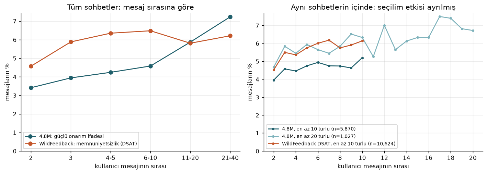
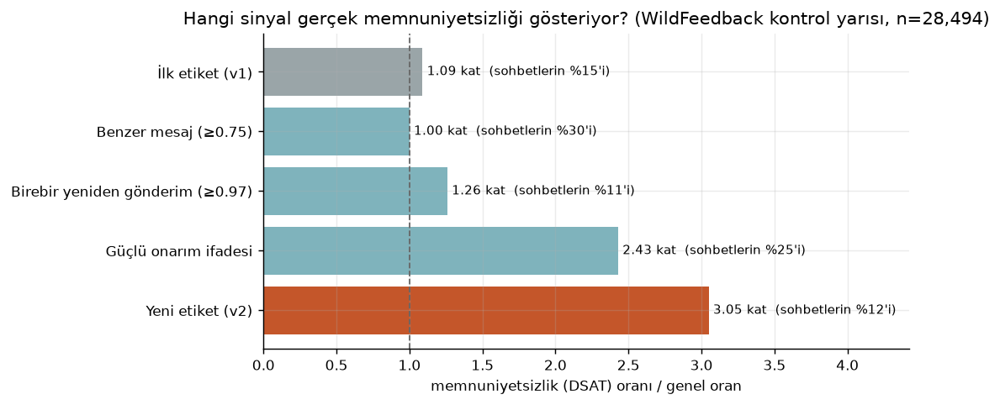
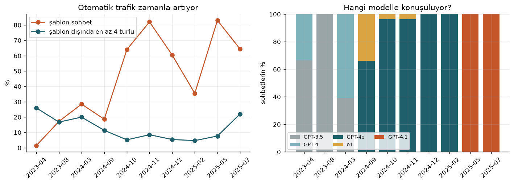
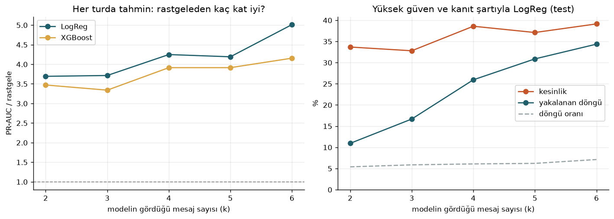

# KafiAI

### Üretken yapay zeka sohbetlerinde verimsiz döngülerin erken fark edilmesi

Samsung Innovation Campus Yapay Zeka programı 18. dönem bitirme projesi, Grup 1. Program UNDP Türkiye ve Yeşilay iş birliğiyle yürütülüyor; bu yılın teması **dijital bağımlılık**.

**Kısaca: ekran süresi değil, kısır döngü.**

---

## Proje hakkında

ChatGPT ve Gemini gibi yapay zeka asistanları ders çalışmanın ve iş yapmanın sıradan bir parçası oldu. Yoğun kullanımla birlikte bir alışkanlık da ortaya çıkıyor: aynı isteği tekrar tekrar göndermek, "olmadı, tekrar yaz" diye defalarca düzeltmeye çalışmak. Sohbet uzuyor, ilerleme duruyor.

Dijital iyi oluş araçları bunu göremiyor, çünkü yalnızca **süreyi** ölçüyorlar. İki saatlik verimli bir çalışma ile iki saat aynı yerde dönmek arasındaki fark sürede değil, **kullanım biçiminde**. Bu projede tek bir göstergeye odaklanıyoruz:

**Verimsiz döngü:** kullanıcının bir önceki cevabın işe yaramadığını tekrar tekrar söylediği ya da aynı isteği yeniden gönderdiği, uzayan ama sonuca ulaşmayan sohbet.

Projenin ilk taslağında ikinci bir gösterge olarak "aşırı güven ve düşünme devri" de vardı. Sohbet verisinden güvenilir biçimde ölçülemediği için kapsamdan çıkarıldı; gelecek çalışma olarak duruyor.

**Hedef grup:** Ders ve iş için üretken yapay zeka kullanan 18 ile 30 yaş arası yetişkinler.

---

## Ürün: KafiAI Chrome eklentisi

`extension/` klasöründe ChatGPT ve Gemini'nin web arayüzünde çalışan bir Chrome eklentisi (Manifest V3, TypeScript) var. Bugün yaptıkları:

| Özellik | Ne yapar | Ne zaman |
|---|---|---|
| **Benzer mesaj şeridi** | Gönder'e basıldığında mesaj son 5 mesajla karşılaştırılır; neredeyse aynıysa mesaj gönderilmeden önce kısa bir şerit çıkar: "Yine de gönder", onarım düğmeleri ("Biçim yanlış", "Bilgi yanlış", "Fazla uzun", "Fazla kısa"), "Yerinde değildi". | Benzerlik 0,8 ve üstü ([K14](docs/05_architecture_decisions.md)). Mesaj öncekinde olmayan yeni bir içerik kelimesi getiriyorsa ("1. soruyu çöz" / "2. soruyu çöz") şerit çıkmaz ([K20](docs/05_architecture_decisions.md)) |
| **Çıkış kartı** | Cevap bittikten sonra, kullanıcı yazmaya başlamadan çıkar. "Taze başlat" sohbetteki istekleri tek bir taslakta toplar, panoya kopyalar ve yeni sohbet açar. | İki yoldan biriyle: sohbet, görev türünün normunu aştı ve tekrar görüldü ([K14](docs/05_architecture_decisions.md)); ya da tur modeli yüksek güvenle döngü tahmin etti ve sohbette en az bir "olmadı" ifadesi var ([K17](docs/05_architecture_decisions.md)) |
| **Gerekçeli öneri** | Model kaynaklı kart nedenini ve somut bir öneriyi söyler; örneğin "Son mesajında bir önceki cevabın işe yaramadığını söyledin. Neyin yanlış olduğunu ve tam olarak ne beklediğini tek cümleyle yazmak…" | Model kartında |
| **Araç çubuğu penceresi** | Eklentiyi, önerileri ve çıkış kartını açıp kapatma; son 7 günün sayaçları; "Sayaçlarımı kopyala"; "Tüm verilerimi sil". | Her zaman |
| **Karşılama ekranı** | Eklenti ilk kurulduğunda bir sekmede açılır: neye baktığını, neye bakmadığını ve verinin nerede durduğunu söyler. Araç çubuğu penceresindeki "KafiAI nasıl çalışır?" bağlantısıyla yeniden açılır. | İlk kurulumda ve istendiğinde ([K21](docs/05_architecture_decisions.md)) |
| **Yalnızca say** | Öneriler kapalıyken hiçbir şey gösterilmez, yalnızca "gösterilecek olsaydı" sayılır. Pilot karşılaştırması için. | Ayarlardan |

**Tur modeli.** Eklenti, kullanıcının her yeni mesajında o ana kadarki kullanıcı mesajlarından 22 sayı hesaplar ve sohbetin döngüye girme olasılığını tahmin eder. Model 22 katsayılı bir Logistic Regression; eklentide yaklaşık 2 KB'lık bir JSON dosyası ([`turn-model.json`](extension/src/data/turn-model.json)) olarak duruyor, kütüphane kullanmadan çalışıyor. Python ile eklentinin aynı sohbete aynı sonucu verdiği parite testleriyle kontrol ediliyor. Ayrıntılar: [Bölüm 9](docs/09_turn_model.md).

**Henüz olmayanlar.** Claude, Copilot ve Google AI Modu desteği; mesaj kutusu kenarındaki halka göstergesi; YEDAM ya da başka bir destek kanalına yönlendirme (ikinci dalga, [Bölüm 6](docs/06_product_scope.md)). Güncel durum tablosu: [Bölüm 6, Uygulama durumu](docs/06_product_scope.md).

### Gizlilik

- Mesaj metni yalnızca sekmenin belleğinde durur; sekme kapanınca silinir. `chrome.storage` içinde yalnızca ayarlar ve günlük sayılar (90 gün) tutulur. Konsola metin değil, yalnızca uzunluk, skor ve olasılık yazılır.
- Eklentide ağ isteği yapan kod yoktur. Eklenti sayfaları ve arka plan çalışanı için manifestte `connect-src 'none'` var. İçerik betiği ChatGPT ve Gemini sayfasının içinde çalıştığı için bu kural onu kapsamaz; içerik betiği için güvence [`no-network.test.ts`](extension/src/no-network.test.ts): derlenmiş kodda `fetch`, `XMLHttpRequest`, `WebSocket`, `sendBeacon`, `EventSource` ve `importScripts` geçmediğini her test çalıştırmasında denetler ([K11](docs/05_architecture_decisions.md)).
- Eklenti yalnızca `storage` ve `clipboardWrite` izni ister ve yalnızca chatgpt.com, chat.openai.com ve gemini.google.com adreslerinde çalışır.

### Kurulum (geliştirici modu)

```bash
cd extension
npm install
npm test             # 359 test
npm run build        # çıktı: extension/dist
```

Chrome'da `chrome://extensions` sayfasını aç, **Geliştirici modu**nu aç, **Paketlenmemiş öğe yükle** ile `extension/dist` klasörünü seç. Kurulumdan hemen sonra karşılama ekranı açılır. ChatGPT ya da Gemini sekmesini yenile. Ne olduğunu görmek için sayfada geliştirici konsolunu açıp `[KafiAI]` diye süz.

---

## Öne çıkan bulgular

Her sayının yanında, sayının durduğu dosya ve anahtar var. Yöntem ve sınırlar: [`scripts/compute_findings.py`](scripts/compute_findings.py), [Bölüm 2](docs/02_data_research.md) ve [Bölüm 8](docs/08_data_preparation_and_model.md).

| Bulgu | Değer | Kaynak |
|---|---|---|
| Programların otomatik gönderdiği şablon sohbetlerin payı | WildChat 1M'de **%16,3**, WildChat 4.8M'de **%44,2** | `outputs/findings.json` → `1m.templated_pct`, `48m_sample.templated_pct` |
| En az 3 turlu gerçek sohbetlerde, kullanıcının en az bir kez öncekine çok benzeyen bir mesaj gönderdiği sohbetler | 1M'de **%24,9**, 4.8M'de **%21,9** | `findings.json` → `*.repeat.conversations_with_similar_pct` |
| Aynı oran 10 tur ve üzeri sohbetlerde | 1M'de **%38,4**, 4.8M'de **%36,8** | `findings.json` → `*.repeat.similar_by_length_pct.10+` |
| Mesajın birebir yeniden gönderildiği sohbetler | 1M'de **%9,3**, 4.8M'de **%8,1** | `findings.json` → `*.repeat.conversations_with_exact_pct` |
| Kullanıcının "olmadı, hâlâ hata" gibi bir ifade yazdığı mesajların oranı, 2. mesajda ve 21. mesaj ve sonrasında | **%3,9 → %7,5**, mesaj başına yaklaşık **2 kat** | `findings.json` → `repair_per_message_48m` |
| 4.8M'de döngüye giren sohbetler (en az 4 turlu gerçek sohbetler) | **%6,7**; kod ve hata ayıklama sohbetlerinde **%19,8** | `outputs/dataset_summary_48m.json` → `positive_rate_pct`; `outputs/eda_48m_summary.json` → `train_tables.48m.label_v2_by_task_pct.kod` |
| En yoğun %1 kullanıcının sohbetlerdeki payı (şablonlar hariç, 1M) | **%23,9** (en yoğun %10: **%51,6**) | `findings.json` → `1m.concentration_organic` |
| Tur modeli, test kullanıcılarında | PR-AUC **0,251** (rastgele 0,066); kart açıldığında isabet **%37,6** | `outputs/turn_model_metrics.json` → `models.logreg.test` |

**Bu sayıları okurken:**

- Benzerlik eklentinin kendi hesabıyla ölçüldü (karakter 3-gram, eşik 0,8). 12 karakterden kısa mesajlar ("devam et", "evet") ve şablonlar hariç. İlk keşif analizindeki %31,6 bu ayrımları yapmıyordu.
- Benzer mesaj tek başına sorun anlamına gelmiyor. WildFeedback'teki memnuniyetsizlik işaretleriyle karşılaştırınca benzer mesaj içeren sohbetlerde memnuniyetsizlik genel orandan farksız çıktı (1,00 kat), çoğu "AA için listele, AB için listele" gibi verimli seri işler. Döngü etiketimiz bu yüzden onarım ifadelerine dayanıyor (2,87 kat). Kaynak: `outputs/label_validation.json`.
- Mesaj başına onarım oranının sohbet uzadıkça artması, dil modellerinin uzun sohbette yolunu kaybettiği bulgusuyla (Laban vd., 2025) aynı yönde; ama nedenini göstermiyor. Uzun sohbetler zaten sorunlu sohbetlerden oluşuyor olabilir. Aynı uzun sohbetlerin içinde de artış görülüyor ([Şekil 25](figures/25_repair_by_turn.png)).
- **Gece kullanımı öne çıkmıyor.** Türkiye'den gelen şablonsuz sohbetlerde yerel saatle 00:00 ile 05:59 arasının kullanıcı ağırlıklı payı 1M'de %18,0 (%95 güven aralığı %12,9 ile %23,1), 4.8M'de %15,3 (%12,4 ile %18,4). Saatler eşit dağılsaydı bu 6 saatin payı %25 olurdu. İlk analizdeki sohbet bazlı %30,7'nin büyük kısmı birkaç yoğun kullanıcıdan geliyordu. Kaynak: `findings.json` → `*.turkey_night`.
- İlk analizdeki "uzun sohbetlerde memnuniyetsizlik yaklaşık 7 kat" sohbet başına hesaplanmıştı; uzun sohbetin daha çok mesajı olduğu için şişkindi. Mesaj başına artış yaklaşık 2 kat (yukarıdaki tablo).

| | |
|---|---|
|  **Sohbet uzadıkça "olmadı" oranı artıyor.** Sağda aynı uzun sohbetlerin içinde. |  **Benzer mesaj tek başına memnuniyetsizlik göstermiyor;** onarım ifadeleri gösteriyor. |
|  **WildChat 4.8M'de otomatik trafik zamanla artıyor;** temizleme olmadan model bunu öğrenirdi. |  **Model sohbet ilerledikçe daha iyi görüyor;** 6. turda rastgelenin 4,7 katı. |

---

## Bu repoyu nasıl okumalı?

**Kısaca anlamak için:** bu sayfa, [Bölüm 6, Ürün kapsamı](docs/06_product_scope.md) ve [Bölüm 9, Tur modeli](docs/09_turn_model.md).

| Soru | Nereye bakmalı |
|---|---|
| Hangi çalışmalara dayanıyorsunuz? | [Bölüm 1, Literatür taraması](docs/01_literature_review.md) |
| İlk veri analizi | [Bölüm 2, Veri araştırması](docs/02_data_research.md) |
| Neden bu teknolojiler? | [Bölüm 3, Teknoloji incelemesi](docs/03_technology_review.md) |
| Proje önerisi | [Bölüm 4, Konsept notu](docs/04_concept_note.md) |
| Hangi kararı neden aldınız? | [Bölüm 5, Mimari kararlar](docs/05_architecture_decisions.md) (K01 ile K17) |
| Ürün neyi yapıyor, neyi yapmıyor? | [Bölüm 6, Ürün kapsamı](docs/06_product_scope.md) |
| Veri setleri ve kaynaklar | [Bölüm 7, Kaynaklar](docs/07_resources.md) |
| Veri hazırlama, etiket, model karşılaştırması | [Bölüm 8](docs/08_data_preparation_and_model.md) |
| Eklentideki model, kalibrasyon, gerekçeler | [Bölüm 9](docs/09_turn_model.md) |

---

## Repo yapısı

```
SIC_AI_18_Capstone_Group_1/
├── README.md
├── requirements.txt                Python paketleri
├── docs/                           Rapor bölümleri 01 ile 09, diyagramlar
├── src/kafiai/                     Python paketi
│   ├── data.py                     Veri kaynakları ve 6 adımlı temizleme
│   ├── labels.py, text.py          Döngü etiketi ve güçlü onarım ifadeleri
│   ├── features.py                 İlk iki mesajdan öznitelikler (Bölüm 8)
│   ├── turn_features.py            Her turda öznitelikler (eklentiyle aynı)
│   ├── turn_model.py               Tur modelinin tahmin hesabı (eklentiyle aynı)
│   ├── extension_similarity.py     Eklentinin benzerlik hesabının Python ikizi
│   └── tasks.py, split.py, config.py
├── scripts/                        Veri indirme, analiz, eğitim ve değerlendirme
├── tests/                          Python testleri ve Python ile eklentinin ortak örnekleri
├── extension/                      Chrome eklentisi
│   ├── src/adapters/               ChatGPT ve Gemini sayfalarını okuma
│   ├── src/core/                   Tekrar, onarım, görev türü, tur modeli, çıkış kartı kuralı
│   ├── src/ui/                     Şerit ve çıkış kartı
│   ├── src/data/                   Model, kurallar ve metinler (JSON; Python da okur)
│   └── public/manifest.json
├── figures/                        Grafikler 01 ile 28
├── outputs/                        Tüm sayılar (JSON); README'deki her sayı buradan
└── data/README.md                  Veri kaynakları (ham veri repoya girmez)
```

---

## Veri setleri

| Veri seti | Ne aldık | Projedeki rolü | Lisans |
|---|---|---|---|
| [WildChat 4.8M](https://huggingface.co/datasets/allenai/WildChat-4.8M) | 86 dosyadan zamana yayılmış 10'u: 150 bin rastgele sohbet, 29.508 çok turlu ve 2.403 Türkçe sohbet (Nisan 2023 ile Temmuz 2025) | Ana eğitim ve test verisi | ODC BY |
| [WildChat 1M](https://huggingface.co/datasets/allenai/WildChat-1M) | Sabit tohumla 50 bin sohbet | İlk keşif analizi, farklı dönem testi | ODC BY |
| [WildFeedback](https://huggingface.co/datasets/microsoft/WildFeedback) | 88.920 sohbet ve mesaj düzeyinde memnuniyetsizlik işaretleri | Etiket doğrulaması, dış test | ODC BY |
| [OpenAssistant OASST1](https://huggingface.co/datasets/OpenAssistant/oasst1) | 30 bin mesaj ve kalite puanları | Yalnızca ilk keşif analizi | Apache 2.0 |

Ham veri repoya girmez; scriptler veriyi `data/processed/` altına indirir.

---

## Her şeyi baştan üretmek

```bash
git clone https://github.com/edasaruhan/SIC_AI_18_Capstone_Group_1.git
cd SIC_AI_18_Capstone_Group_1
python3 -m venv .venv && source .venv/bin/activate
pip install -r requirements.txt

python scripts/run_eda.py                     # WildChat 1M örneklemi ve ilk analiz
python scripts/fetch_wildchat48.py            # yaklaşık 2 GB
python scripts/fetch_wildfeedback.py          # yaklaşık 0,6 GB
python scripts/build_dataset.py --source 48m  # ayrıca 48m_turkish, 1m, wildfeedback
python scripts/run_eda_48m.py                 # Şekil 16-19, 25
python scripts/compute_findings.py            # outputs/findings.json, README bulguları
python scripts/train_models.py                # Bölüm 8 model karşılaştırması
python scripts/build_turn_dataset.py --source 48m   # ayrıca 48m_turkish, 1m, wildfeedback
python scripts/train_turn_model.py            # eklentinin modeli, Şekil 26-28
python scripts/make_turn_parity_fixture.py    # model değiştiyse mutlaka
python -m pytest tests
```

---

## Yaklaşımımızın ilkeleri

- **Yasak değil, yönlendirme.** Eklenti hiçbir şeyi engellemez, süre sınırı koymaz. Öneriler kapatılabilir.
- **Etiketleme değil, farkındalık.** Kimseye "bağımlısın" denmez, puan, seri ya da rozet yoktur; yalnızca kullanım biçimindeki örüntü görünür kılınır.
- **Gizlilik öncelikli.** Mesajlar cihazda işlenir ve saklanmaz; eklentide ağ isteği yapan kod yoktur.
- **Açıklanabilirlik.** Her öneri nedenini söyler.
- **Suçlamayan dil.** Döngünün bir kısmı modelin uzun sohbette yolunu kaybetmesinden geliyor; metinler bunu da söyler.
- **Profesyonel desteğin yerini almaz.** Destek kanallarına yönlendirme ikinci dalgada, kullanıcının isteğiyle ve tek bir sohbete bakılarak değil.
