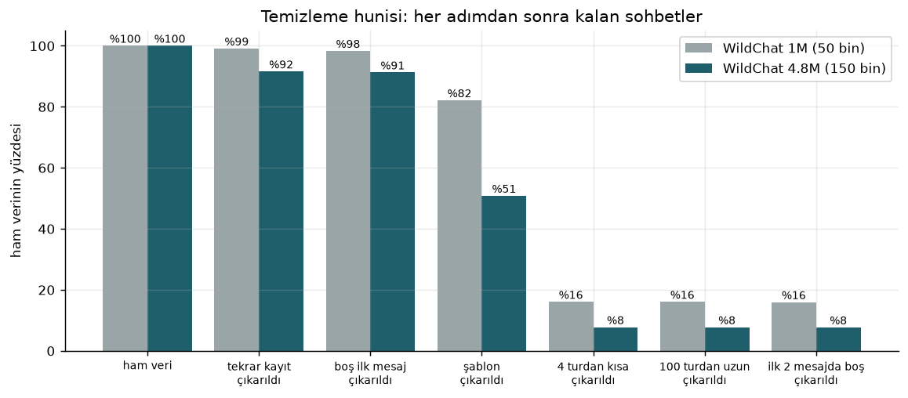
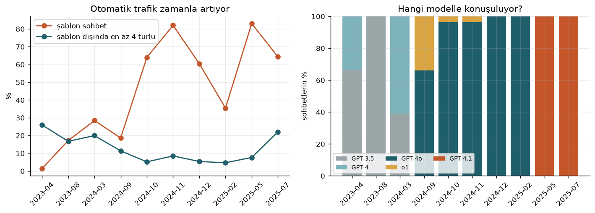
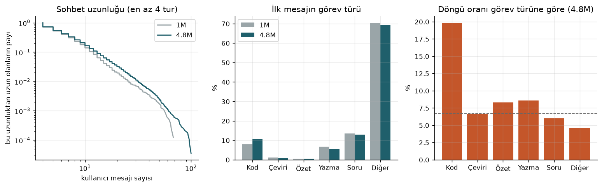
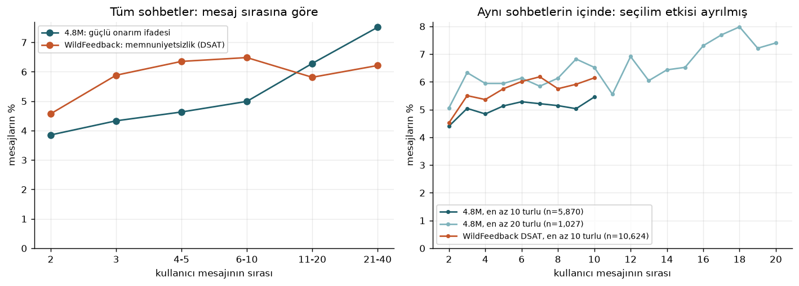
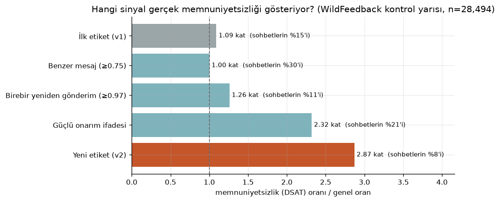
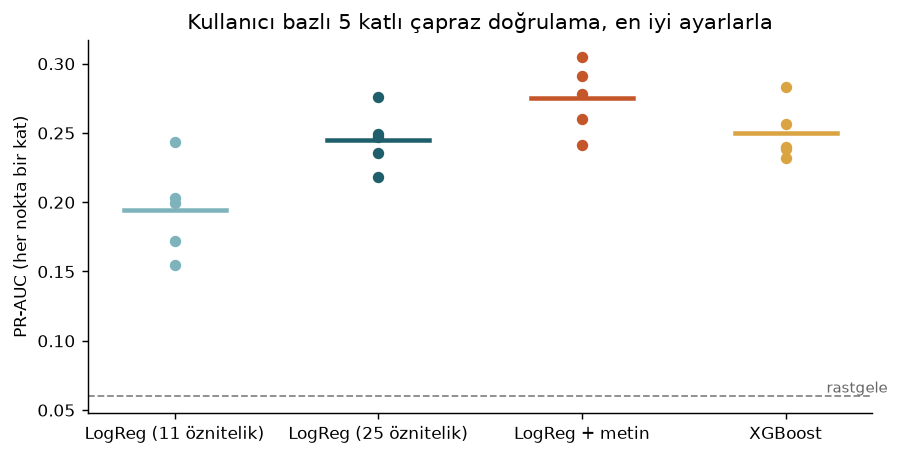
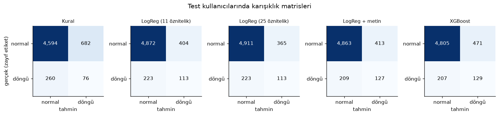
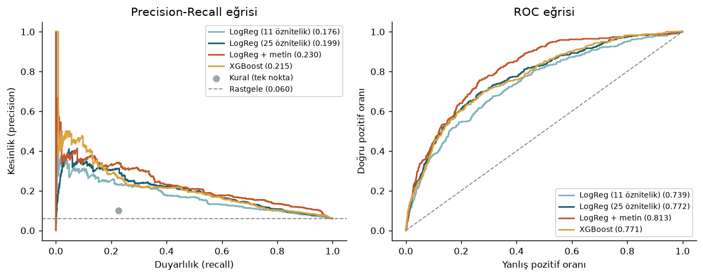
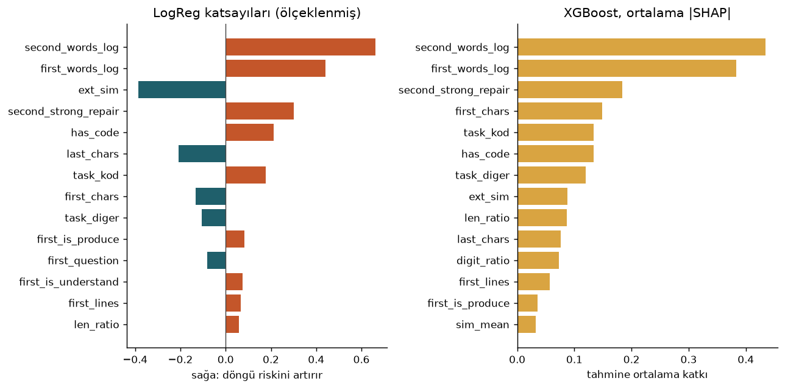
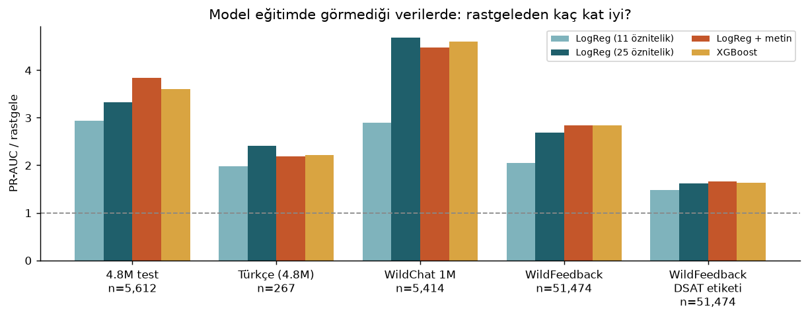

# Bölüm 8: Veri Hazırlama, Feature Engineering ve Model Keşfi

**Proje:** KafiAI, üretken yapay zeka sohbetlerinde verimsiz döngülerin erken tespiti
**Ekip:** SIC AI 18, Grup 1

Bu bölüm, ilk iki mesajdan sohbetin döngüye girip girmeyeceğini tahmin eden modelin verisinin nasıl hazırlandığını ve hangi modellerin nasıl denendiğini anlatıyor. Bölüm 2'deki keşif analizi WildChat 1M üzerindeydi; bu aşamada ana veriyi daha büyük ve güncel olan **WildChat 4.8M**'e taşıdık, etiketi **WildFeedback** ile dışarıdan doğruladık ve modelleri kullanıcı bazlı çapraz doğrulamayla karşılaştırdık.

Tüm sayılar `outputs/` altındaki JSON dosyalarından, tüm grafikler `figures/` altından geliyor. Bölümün sonundaki komutlar her şeyi baştan üretir.

---

## Veri Hazırlama ve Feature Engineering

### 1. Genel Bakış

Bu projede modelin başarısını belirleyen asıl şey modelin türü değil, verinin ve etiketin kalitesi oldu. Üç nedenden:

1. **Ham veri büyük ölçüde gerçek kullanıcı değil.** WildChat 4.8M'in rastgele örnekleminde sohbetlerin yaklaşık %44'ü programların otomatik gönderdiği hazır isteklerden oluşuyor. Temizlenmeden kullanılsaydı model insan davranışını değil bu trafiği öğrenirdi.
2. **Hazır bir "döngü" etiketi yok.** Etiketi kendimiz üretiyoruz; etiket yanlışsa model ne kadar iyi olursa olsun yanlış şeyi öğrenir. Bu aşamada ilk etiketimizin beklediğimiz kadar iyi olmadığını gördük ve yeniden tasarladık (Bölüm 5.1).
3. **Model tarayıcıda çalışacak.** Öznitelikler eklentinin kullanıcının ilk iki mesajından anında hesaplayabileceği, açıklanabilir sayılar olmak zorunda.

Akış şöyle:

| Adım | Ne yapılıyor | Kod |
|---|---|---|
| 1. Toplama | WildChat 4.8M'den zamana yayılmış 10 dosya, WildChat 1M örneklemi, WildFeedback | `fetch_wildchat48.py`, `fetch_wildfeedback.py` |
| 2. Temizleme | Tekrar kayıt, boş mesaj, şablon, kısa ve aykırı uzun sohbetler çıkarılıyor | `data.clean_conversations` |
| 3. Etiket | Yalnızca 3. mesaj ve sonrasından: sohbet döngüye girdi mi | `labels.loop_label` |
| 4. Öznitelik | Yalnızca ilk 2 kullanıcı mesajından 25 sayı ve bir metin vektörü | `features.conversation_features` |
| 5. Bölme | Eğitim ve test kullanıcıya göre ayrılıyor | `split.user_split` |
| 6. Model | 5 yöntem, kullanıcı bazlı 5 katlı çapraz doğrulama | `train_models.py` |
| 7. Dış test | Türkçe sohbetler, WildChat 1M, WildFeedback (DSAT) | `train_models.py` |

### 2. Veri Toplama

| Kaynak | Ne aldık | Boyut | Rolü | Lisans |
|---|---|---|---|---|
| [WildChat 4.8M](https://huggingface.co/datasets/allenai/WildChat-4.8M) | 86 parça dosyadan eşit aralıklı 10 tanesi | 150.000 sohbetlik rastgele örneklem, 29.508 çok turlu sohbet, 2.403 Türkçe sohbet | Ana eğitim verisi, keşif analizi | ODC BY |
| [WildChat 1M](https://huggingface.co/datasets/allenai/WildChat-1M) | Bölüm 2'deki 50.000 sohbetlik örneklem | 7.965 eğitilebilir sohbet | Farklı dönem testi | ODC BY |
| [WildFeedback](https://huggingface.co/datasets/microsoft/WildFeedback) | `sat_dsat_annotation` alt kümesi | 1.017.754 mesaj, 88.920 sohbet | Etiket doğrulaması, dış test | ODC BY |

**WildChat 4.8M neden?** 1M sürümü Nisan 2023 ile Nisan 2024 arasını, 4.8M ise Temmuz 2025'e kadarını kapsıyor. GPT-4o, o1 ve GPT-4.1 ile yapılan sohbetler yalnızca bu sürümde var (Şekil 17); hedef kitlemizin bugün kullandığı araçlara çok daha yakın. Türkçe sohbet sayısı da belirgin şekilde fazla.

**Nasıl örneklem aldık?** Verinin tamamı 15,3 GB. Parça dosyalar zamana göre sıralı olduğu için baştan sona eşit aralıklı 10 dosya seçtik (0, 9, 19, 28, 38, 47, 57, 66, 76 ve 85 numaralı dosyalar). Her dosyadan sabit bir rastgelelik tohumuyla (`SEED = 42`) 15.000 sohbet aldık; bu 150.000 sohbet keşif analizinde kullanıldı. Model yalnızca en az 4 turlu sohbetlerle eğitilebildiği için aynı dosyalardaki **tüm** çok turlu sohbetleri ve tüm Türkçe sohbetleri ayrıca kaydettik.

**Toplama sırasındaki ön işleme.** Her sohbetten yalnızca kullanıcı mesajları, zaman damgası, model adı, dil, ülke ve şifrelenmiş IP (`hashed_ip`) tutuldu. Asistan cevaplarının yalnızca toplam uzunluğu saklandı; metinleri modelde kullanılmıyor. Kullanıcı mesajları 2.000 karakterde kesildi: model zaten ilk 1.000 karaktere bakıyor (`config.MAX_CHARS`) ve bu sınır dosya boyutunu 65 MB'ta tutuyor.

WildFeedback'te sohbet kimliği yok; veri mesaj mesaj tutuluyor. Her sohbette mesaj numarası (`UtterranceId`) sıfırdan başladığı için, numara geriye düştüğü yerde yeni bir sohbet başlatıp mesajları sohbetlere topladık. Her kullanıcı mesajı için "memnuniyetsizlik var mı" (DSAT) işaretini sohbet düzeyinde bir listeye çevirdik.

```python
# scripts/fetch_wildchat48.py: zamana yayılmış parça seçimi
def shard_indices(n):
    """0 ile 85 arasında eşit aralıklı n parça numarası."""
    return sorted(set(np.linspace(0, N_SHARDS_TOTAL - 1, n).round().astype(int).tolist()))

# her parçadan aynı sayıda rastgele sohbet, ayrıca tüm çok turlu sohbetler
picked = np.sort(rng.choice(n, size=min(per_shard, n), replace=False))
multi = [j for j, t in enumerate(turns) if t >= MIN_TURNS_FOR_LABEL]
```

### 3. Veri Temizleme

Temizleme `src/kafiai/data.py` içindeki `clean_conversations` fonksiyonunda altı adımda yapılıyor ve her adımdan sonra kaç sohbet kaldığı kaydediliyor. Aynı adımlar dört kaynağa da uygulanıyor.

| Adım | Neden | 1M (50.000) | 4.8M (150.000) |
|---|---|---|---|
| Ham veri | | 50.000 | 150.000 |
| 1. Tekrarlanan kayıtları çıkar | Aynı `conversation_hash` birden fazla kez geçiyor | 49.547 | 137.366 |
| 2. İlk mesajı boş olanları çıkar | Yalnızca dosya ya da görsel gönderilmiş | 49.153 | 136.867 |
| 3. Şablon sohbetleri çıkar | İlk 80 karakteri 20 kez ve üzeri tekrar eden otomatik istekler | 41.058 | **76.211** |
| 4. En az 4 tur | Etiket için ilk 2 turdan sonra en az 2 tur gerekiyor | 8.023 | 11.569 |
| 5. 100 turdan uzunları çıkar | Aykırı değer (aşağıda) | 8.022 | 11.560 |
| 6. İlk 2 mesajı dolu olanlar | Öznitelikler bu iki mesajdan hesaplanıyor | 7.965 | 11.476 |



*Şekil 16. Temizleme hunisi. İki veri setinde de en büyük kayıp şablon sohbetlerden geliyor; 4.8M'de bu kayıp çok daha büyük.*

**Tekrarlanan kayıtlar.** 4.8M örnekleminde 12.634 sohbet (%8,4) aynı `conversation_hash` ile birden fazla kez geçiyor; 1M'de bu sayı 453. Bunların neredeyse tamamı aynı hazır isteğin tekrar tekrar gönderilmesi.

**Şablon trafiği ve zaman.** Şablon oranı 1M'de %16,5 iken 4.8M'de ilk temizlik adımlarından sonra %44. Şekil 17 bunun zamanla nasıl değiştiğini gösteriyor: 2023 başında %1 olan oran, 2024 sonundan itibaren dönemine göre %35 ile %83 arasında. Bu dönemlerde gerçek, çok turlu sohbetlerin payı %5'in altına iniyor. Eğitim verisini rastgele örneklem yerine çok turlu sohbetlerin tamamından kurmamızın nedeni bu.

**Eksik değerler.** Model için gereken alanlarda (kullanıcı mesajları, `hashed_ip`, zaman damgası) eksik değer yok. Eksik değer yalnızca `country` alanında var (1M'de %0,1, 4.8M'de %5,8); bu alan modelde kullanılmadığı için silinmedi, "Bilinmiyor" olarak dolduruldu. Boş mesajlar ise eksik değer gibi davranıyor ve 2. ve 6. adımlarda çıkarıldı.

**Aykırı değerler.** Sohbet uzunluğu çok çarpık bir dağılıma sahip: 4.8M örnekleminde sohbetlerin %99'u 12 turun, %99,9'u 30 turun altında, ama en uzun sohbet 209 tur. Böyle bir sohbet tek başına onlarca tekrar ve onarım ifadesi içerebildiği için etiket sayımını çarpıtabiliyor; 100 turu aşan sohbetler çıkarıldı (`config.MAX_TURNS = 100`). Bu adım yalnızca birkaç sohbeti etkiliyor. Mesaj uzunluğundaki aykırı değerler ise silinmedi, kesildi (1.000 karakter) ve uzunluk öznitelikleri log ölçeğine alındı (Bölüm 6).

**Veri sızıntısına karşı.** İki kural var. (1) Öznitelikler yalnızca ilk iki kullanıcı mesajından, etiket yalnızca üçüncü mesaj ve sonrasından hesaplanıyor; `tests/test_kafiai.py` bunu test ediyor. (2) Eğitim ve test verisi kullanıcıya göre ayrılıyor (`hashed_ip`); aynı kişinin sohbetleri iki tarafta birden olmuyor. WildFeedback de WildChat'ten türediği için, eğitim verisindeki sohbetlerle ilk iki mesajı birebir aynı olan 5.244 WildFeedback sohbeti dış testten çıkarıldı.

```python
# src/kafiai/data.py: temizleme adımlarından ikisi
df = df.drop_duplicates("conversation_hash")
steps["tekrar kayıtlar çıkarıldı"] = len(df)

df = df[df["n_user_msgs"] <= MAX_TURNS]   # aykırı uzunluk
steps[f"{MAX_TURNS} turdan uzunlar çıkarıldı"] = len(df)
```

### 4. Keşifsel Veri Analizi (EDA)

1M üzerindeki ayrıntılı analiz [Bölüm 2](02_data_research.md)'de. Burada 4.8M'in getirdiği farklara ve eğitim tablosuna odaklanıyoruz.



*Şekil 17. Solda: şablon sohbet oranı ve şablon dışında en az 4 turlu sohbet oranı. Sağda: her dönemde hangi modelle konuşulduğu.*

**Kullanılan modeller değişiyor.** 2023'te sohbetlerin tamamı GPT-3.5 ve GPT-4 ile; Eylül 2024'ten sonra GPT-4o ve o1, 2025 ortasında GPT-4.1. 1M ile eğittiğimiz bir model bugünkü modellerle yapılan sohbetleri hiç görmemiş olurdu.



*Şekil 18. Temizlenmiş eğitim tablolarında sohbet uzunluğu, ilk mesajın görev türü ve görev türüne göre döngü oranı.*

**Eğitim tabloları birbirine benziyor.** Temizlikten sonra iki sürümde de çok turlu sohbetlerin medyanı 6 tur; uzunluk dağılımları neredeyse üst üste. Görev türü dağılımı da benzer; 4.8M'de kod sohbetlerinin payı biraz daha yüksek (%10,6'ya karşı %7,9). Bu, temizlemenin iki dönemi aynı türden "gerçek kullanıcı" verisine indirdiğini gösteriyor.

**Döngü en çok kod sohbetlerinde.** Yeni etikete göre kod yazma ve hata ayıklama ile başlayan sohbetlerin %19,8'i döngüye giriyor; genel oran %6,7, soru ve açıklama sohbetlerinde %6,0. Bu, çıkış kartının görev türüne göre ayarlanması kararını da destekliyor (Bölüm 5, K14).

| Eğitim tablosu | Sohbet | Kullanıcı | Dönem | İlk etiket (v1) | Yeni etiket (v2) |
|---|---|---|---|---|---|
| WildChat 4.8M | 28.123 | 12.352 | Nis 2023 ile Tem 2025 | %10,2 | %6,7 |
| WildChat 1M | 7.965 | 4.608 | Nis 2023 ile Nis 2024 | %11,0 | %4,6 |
| 4.8M Türkçe | 267 | 146 | Nis 2023 ile Tem 2025 | %14,2 | %9,0 |
| WildFeedback | 56.718 | (kimlik yok) | 1M dönemi | %14,6 | %8,3 |

**Sohbet uzadıkça ne oluyor?** Projenin çıkış noktalarından biri, dil modellerinin uzun sohbette yolunu kaybetmesi: önde gelen modeller çok turlu sohbetlerde tek turlu kullanıma göre ortalama %39 daha düşük başarı gösteriyor ve yanlış bir yola saptıklarında toparlanamıyor (Laban vd., 2025). Bunun kullanıcı tarafındaki izini aradık: mesaj sırası ilerledikçe kullanıcının "olmadı, hâlâ hata veriyor" gibi bir güçlü onarım ifadesi yazma oranı (4.8M) ve WildFeedback'te memnuniyetsizlik işaretli mesaj oranı nasıl değişiyor?



*Şekil 25. Solda tüm sohbetlerde mesaj sırasına göre oranlar. Sağda yalnızca en az 10 (ve 20) turlu sohbetler: her noktada aynı sohbet kümesine bakıldığı için "uzun sohbetler zaten sorunlu" etkisi ayrılmış oluyor.*

| Kullanıcı mesajı | 4.8M: güçlü onarım ifadesi | WildFeedback: memnuniyetsizlik |
|---|---|---|
| 2. mesaj | %3,9 | %4,6 |
| 3. mesaj | %4,3 | %5,9 |
| 4 ile 5 | %4,6 | %6,3 |
| 6 ile 10 | %5,0 | %6,5 |
| 11 ile 20 | %6,3 | %5,8 |
| 21 ile 40 | %7,5 | %6,2 |

Bulgular ve sınırları:

- 4.8M'de onarım ifadesi oranı 2. mesajdan 21. mesaj ve sonrasına yaklaşık **iki katına** çıkıyor.
- Bunun bir kısmı seçilim etkisi: uzun sürmüş sohbetler zaten sorun yaşanan sohbetler. Bunu ayırmak için yalnızca en az 20 turlu 1.027 sohbete bakınca da oran aynı sohbetlerin içinde 2. mesajda %5,1'den 17 ile 20. mesajlarda %7,2 ile %8,0 arasına çıkıyor. En az 10 turlu sohbetlerde artış daha küçük (%4,4'ten %5,5'e). Yani sohbet ilerledikçe sorun yaşama oranı aynı sohbet içinde de artıyor.
- WildFeedback'te artış ilk turlarda belirgin (%4,6'dan %6,5'e), 10. mesajdan sonra düzleşiyor. İki veri seti aynı eğriyi vermiyor; WildFeedback'in uzun sohbetleri az ve etiketleri farklı bir yöntemle üretilmiş.
- Bu analiz, modelin bağlam penceresi (context window) içinde bilgiyi kaybettiğini doğrudan göstermiyor; yalnızca kullanıcı tarafında görünen sonucu ölçüyor. Laban vd.'nin kontrollü deneydeki bulgusuyla **aynı yönde** olduğunu söyleyebiliyoruz, nedenini kanıtladığını değil.

Bu bulgu eklentinin "taze başlat" önerisinin gerekçesini veriyle destekliyor: uzayan bir sohbette isteği toparlayıp yeni bir sohbete taşımak, aynı sohbette devam etmekten daha az sorunla sonuçlanabilir. Bunu doğrudan test etmek pilot çalışmanın işi.

**Sınıf dengesizliği.** Pozitif sınıf (döngü) yaklaşık %7. Bu yüzden doğruluk (accuracy) yerine PR-AUC ana metrik; rastgele bir modelin PR-AUC değeri pozitif oranına eşit olduğu için sonuçları hep "rastgeleden kaç kat iyi" diye de veriyoruz. Modellerde sınıf ağırlıkları dengelendi (Bölüm 6).

### 5. Feature Engineering

#### 5.1 Etiketin yeniden tasarlanması

Feature engineering'e etiketten başlamamız gerekti, çünkü bu aşamanın en önemli bulgusu etiketle ilgili.

**İlk etiket (v1)** iki sinyale dayanıyordu: ilk iki turdan sonra en az 2 kez birbirine 0,75 üstü benzeyen mesaj ya da en az 2 onarım ifadesi. WildFeedback'teki DSAT işaretleriyle karşılaştırdığımızda bu etiketin işaretlediği sohbetlerde memnuniyetsizlik oranının genel orandan neredeyse farksız olduğunu gördük (1,09 kat). Örneklere bakınca nedeni açıktı: "AA ile başlayan uyduları listele", "AB ile başlayan…", "AC ile başlayan…" gibi **verimli seri işler** birbirine çok benzediği için döngü sayılıyordu.

Bunun üzerine her sinyali tek tek ölçtük. Ölçüm şöyle yapıldı: WildFeedback sohbetleri rastgele iki yarıya bölündü; kurallar yalnızca **geliştirme** yarısına bakılarak seçildi, sonuçlar **kontrol** yarısında raporlandı. İki yarıdaki sonuçlar birbirine çok yakın (`outputs/label_validation.json`).



*Şekil 19. Her sinyalin geçtiği sohbetlerde memnuniyetsizlik oranının genel orana bölümü (WildFeedback kontrol yarısı, 28.494 sohbet). 1'in üstü, sinyalin memnuniyetsizliği gerçekten gösterdiği anlamına geliyor.*

| Sinyal | Sohbetlerin payı | DSAT oranı / genel oran |
|---|---|---|
| İlk etiket (v1) | %14,6 | 1,09 |
| Benzer mesaj (0,75 üstü) | %29,6 | 1,00 |
| Birebir yeniden gönderim (0,97 üstü) | %11,5 | 1,26 |
| Güçlü onarım ifadesi | %20,8 | 2,32 |
| **Yeni etiket (v2)** | **%8,5** | **2,87** |

Benzerlik tek başına memnuniyetsizliği göstermiyor; birebir yeniden gönderim biraz gösteriyor; asıl sinyal kullanıcının "hâlâ hata veriyor", "aynı sorun", "olmadı", "you didn't" gibi ifadeleri. **Yeni etiket (v2)**: ilk iki turdan sonra en az 2 güçlü onarım ifadesi **ya da** 1 güçlü onarım ifadesi ile birlikte 1 birebir yeniden gönderim. Güçlü onarım listesi (`text.STRONG_REPAIR_PATTERNS`) yalnızca memnuniyetsizliği en az 2 kat artıran ifadelerden oluşuyor; "please", "try again" gibi normal iş akışının parçası olan ifadeler bilerek listede yok. Türkçe karşılıkları da eklendi; WildFeedback yalnızca İngilizce olduğu için Türkçe ifadeler henüz doğrulanmadı, bu iş Türkçe elle etiketleme setine kaldı.

```python
# src/kafiai/labels.py
def loop_label(user_messages, k=K_TURNS):
    """Etiketin ikinci sürümü; modeller bununla eğitilir. 0 veya 1 döner."""
    exact, repairs = future_signals_v2(user_messages, k)
    return int(repairs >= LABEL_V2_MIN_REPAIRS or (repairs >= 1 and exact >= 1))
```

Bu karar ürün için de bir şey söylüyor: eklentinin benzer mesaj şeridi (0,8 üstü benzerlik) kullanıcıya "bunu az önce de sordun" demek için doğru bir sinyal, ama tek başına "bu kullanıcı takıldı" demek için yeterli değil. Çıkış kartının yumuşak tekrar sayımını onarım ifadeleriyle birleştirmek bir sonraki adım (Bölüm 5, K15).

#### 5.2 Öznitelikler

Model yalnızca ilk iki kullanıcı mesajını görüyor. İlk sürümdeki 11 özniteliğe 14 yeni öznitelik ekledik. Her birinin seçilme nedeni aşağıda.

| Öznitelik | Ne ölçüyor | Neden |
|---|---|---|
| `sim_mean`, `sim_max` | İlk iki mesajın karakter n-gram benzerliği | Daha ikinci mesajda aynı şeyi tekrar yazan kullanıcı |
| `n_repeats`, `n_repairs` | Eşiği geçen benzerlik ve onarım ifadesi sayısı | İlk sürümden; erken tekrar ve şikâyet |
| `first_chars`, `last_chars`, `len_ratio` | Mesaj uzunlukları ve oranı | Uzun ve belirsiz istekler ile kısa "tekrar yaz" mesajları |
| `short_followup` | İkinci mesaj 30 karakterden kısa mı | "olmadı", "devam" gibi kısa tepkiler |
| `first_is_produce`, `first_is_understand` | İlk isteğin türü (üretim / anlama) | Düşünmeyi devretme ile anlamaya çalışma farkı |
| `has_code` | İlk iki mesajda kod var mı | Hata ayıklama döngüleri |
| **`ext_sim`** | Eklentinin kullandığı benzerlik (3-gram, 1024 boyut) | Modelin eklentide birebir aynı sayıyı görmesi (Bölüm 5, K14) |
| **`first_words_log`, `second_words_log`** | Kelime sayıları, log ölçeğinde | Uzunluk etkisini çarpık dağılımdan arındırmak |
| **`first_lines`** | İlk mesajdaki satır sayısı | Yapıştırılmış metin, kod ya da hata çıktısı |
| **`first_question`, `second_question`** | Mesaj soru işaretiyle bitiyor mu | Soru soran ile iş yaptıran kullanıcı |
| **`digit_ratio`** | Rakam oranı | Sayısal görevler, hata kodları |
| **`second_strong_repair`** | İkinci mesajda güçlü onarım ifadesi | Etiketteki asıl sinyalin erken görünümü |
| **`task_kod` … `task_diger`** | İlk mesajın görev türü (6 kategori) | Döngü oranı görev türüne göre 4 kat değişiyor (Şekil 18) |

Görev türü, eklentinin çıkış kartında kullandığı `task-rules.json` kurallarıyla aynı fonksiyondan (`tasks.task_type`) geliyor; yani modelin gördüğü kategori eklentidekiyle birebir aynı. Hiçbir öznitelik dil modeli ya da internet bağlantısı gerektirmiyor; hepsi tarayıcıda milisaniyeler içinde hesaplanabiliyor.

Ayrıca bir de **metin özniteliği** denedik: ilk iki mesajın 3 ile 5 karakterlik parçaları, eğitim gerektirmeyen bir özetleme (hashing) ile 65.536 boyutlu seyrek bir vektöre çevrildi. Bu, modelin hangi kelimelerin döngüyle ilişkili olduğunu kendisinin öğrenip öğrenemeyeceğini görmek için.

```python
# src/kafiai/features.py: eklenen özniteliklerden bazıları
"ext_sim": extension_similarity(first, second) if second else 0.0,
"first_words_log": math.log1p(len(first.split())),
"first_lines": first.count("\n") + 1,
"second_strong_repair": int(has_strong_repair(second)),
...
for t in TASK_TYPES:
    row[f"task_{t}"] = int(task == t)          # görev türü, one-hot
```

### 6. Veri Dönüştürme

| Dönüşüm | Nerede | Neden |
|---|---|---|
| Küçük harf, boşlukları teke indirme, 1.000 karakterde kesme | `text.clean` | Benzerlik hesabını biçim farklarından arındırmak |
| Türkçe uyumlu normalleştirme (İ→i, I→ı, noktalama → boşluk) | `extension_similarity.normalize_text` | Eklentiyle aynı sonucu vermek |
| Log dönüşümü (`log1p`) | Kelime sayıları | Çok çarpık uzunluk dağılımı |
| One-hot kodlama | Görev türü (6 kategori), istek türü (2 ikili değişken) | Kategorik değişkenleri modele sayı olarak vermek |
| Standartlaştırma (`StandardScaler`) | Logistic Regression'a giren tüm sayısal öznitelikler | Katsayıları karşılaştırılabilir yapmak ve düzenlileştirmeyi (C) tüm özniteliklere eşit uygulamak |
| Ölçekleme yok | XGBoost | Karar ağaçları eşik kullanır, ölçekten etkilenmez |
| Hashing ile vektörleştirme, L2 normu | Metin özniteliği | Sözlük tutmadan, eğitim gerektirmeden sabit boyutlu vektör |
| Sınıf ağırlığı (`class_weight="balanced"`, `scale_pos_weight`) | Tüm öğrenen modeller | Pozitif sınıf yaklaşık %7 |

Standartlaştırma ve hashing, `Pipeline` ve `ColumnTransformer` içinde yapılıyor. Böylece ortalama ve standart sapma her çapraz doğrulama katında yalnızca o katın eğitim kısmından öğreniliyor; doğrulama verisi sızmıyor.

```python
# scripts/train_models.py: sayısal ve metin özniteliklerinin birleştirilmesi
metin = HashingVectorizer(analyzer="char_wb", ngram_range=(3, 5),
                          n_features=2**16, alternate_sign=False, norm="l2")
text_features = ColumnTransformer([
    ("sayisal", StandardScaler(), FEATURE_COLUMNS),   # ölçekleme
    ("metin", metin, "text"),                          # karakter n-gram
])
logreg = LogisticRegression(max_iter=2000, class_weight="balanced")
model = Pipeline([("oznitelik", text_features), ("model", logreg)])
```

Eğitilen Logistic Regression'ın ölçekleme değerleri ve katsayıları `outputs/logreg_model.json` dosyasına yazılıyor. Eklenti bu dosyayı okuyarak aynı tahmini tarayıcıda, kütüphane kullanmadan yapabilir: `olasılık = sigmoid(Σ katsayı × (x − ortalama) / ölçek + sabit)`.

---

## Model Keşfi

### 1. Model Seçimi

Problem bir ikili sınıflandırma: ilk iki mesaja bakıp sohbetin sonradan döngüye girip girmeyeceğini (1) ya da girmeyeceğini (0) tahmin etmek. Beş yöntemi aynı veride karşılaştırdık:

| Yöntem | Ne | Güçlü yönü | Zayıf yönü |
|---|---|---|---|
| **Kural** | Eklentinin bugünkü mantığı: ikinci mesaj birinciye 0,8 üstü benziyorsa ya da ikinci mesajda güçlü onarım ifadesi varsa "risk" | Öğrenme yok, tamamen açıklanabilir | Tek bir eşik; sinyallerin ağırlığını ayarlayamaz |
| **LogReg (11 öznitelik)** | İlk sürümdeki öznitelikler ile Logistic Regression | Ölçüt (baseline): yeni özniteliklerin katkısını gösterir | Görev türü ve güçlü onarım bilgisi yok |
| **LogReg (25 öznitelik)** | Genişletilmiş öznitelikler ile Logistic Regression | Küçük (25 katsayı), hızlı, her katsayı yorumlanabilir; tarayıcıda kütüphanesiz çalışır | Doğrusal; öznitelikler arası etkileşimleri kendi bulamaz |
| **LogReg + metin** | 25 öznitelik ve ilk iki mesajın karakter n-gramları | Hangi kelimelerin döngüyle ilişkili olduğunu kendisi öğrenir | 65.536 ağırlık; yorumlanması ve eklentiye taşınması zor |
| **XGBoost** | 25 öznitelik ile gradyan artırmalı karar ağaçları | Doğrusal olmayan ilişkileri ve etkileşimleri yakalar; SHAP ile açıklanabilir | Daha büyük model; küçük veride aşırı öğrenmeye açık |

Derin öğrenme modelleri (ör. bir dil modelini ince ayarla eğitmek) bilerek denenmedi: eklenti tarayıcıda, internet bağlantısı olmadan ve milisaniyeler içinde çalışmak zorunda (Bölüm 5, K05 ve K11). Ayrıca etiketimiz kurallardan geldiği için çok büyük bir model, etiketin gürültüsünü de öğrenme riski taşır.

### 2. Model Eğitimi

**Veri bölme.** 4.8M eğitim tablosu kullanıcıya göre ikiye ayrıldı: kullanıcıların %80'i eğitim (22.204 sohbet, 9.764 kullanıcı), %20'si test (5.612 sohbet). Türkçe sohbeti olan 146 kullanıcının hiçbir sohbeti eğitime girmedi; Türkçe sohbetler ayrı bir test seti oldu.

**Çapraz doğrulama.** Hiperparametreler eğitim verisi içinde 5 katlı `GroupKFold` ile seçildi. Katlar kullanıcıya göre oluşturuluyor; aynı kişinin sohbetleri hiçbir zaman hem eğitim hem doğrulama katında olmuyor. Seçim ölçütü PR-AUC (`scoring="average_precision"`).

**Hiperparametre araması.**

| Model | Denenen değerler | Seçilen |
|---|---|---|
| LogReg (11 öznitelik) | C: 0,01 / 0,1 / 1 / 10 | C = 1 |
| LogReg (25 öznitelik) | C: 0,01 / 0,1 / 1 / 10 | C = 0,01 |
| LogReg + metin | C: 0,03 / 0,1 / 0,3 / 1 | C = 0,3 |
| XGBoost | max_depth: 3 / 5, n_estimators: 200 / 400, learning_rate: 0,03 / 0,1, min_child_weight: 1 / 5 | 3, 400, 0,03, 5 |

Sabit tutulanlar: Logistic Regression'da `class_weight="balanced"` ve `max_iter=2000`; XGBoost'ta `subsample=0.8`, `colsample_bytree=0.8` ve pozitif sınıf ağırlığı (`scale_pos_weight` = negatif / pozitif sayısı, yaklaşık 14). XGBoost'un en sığ ağaçları (derinlik 3) ve daha temkinli yaprak ayarını (`min_child_weight=5`) seçmesi, veride karmaşık etkileşimlerden çok güçlü birkaç ana etki olduğunu gösteriyor. 25 öznitelikli LogReg'in en güçlü düzenlileştirmeyi (C = 0,01) seçmesi de aynı yönde.

**Karar eşiği.** Modeller olasılık veriyor; "döngü" demek için bir eşik gerekiyor. Eşik test verisine bakılmadan seçildi: eğitim verisinde katlar dışı (out-of-fold) tahminler üretildi ve F1'i en yüksek yapan eşik alındı.

```python
# scripts/train_models.py: arama, eşik seçimi ve test
cv = GroupKFold(n_splits=CV_FOLDS, shuffle=True, random_state=SEED)
search = GridSearchCV(estimator, grid, scoring="average_precision", cv=cv, refit=True)
search.fit(train[columns], y_train, groups=groups)   # gruplar: hashed_ip

oof = cross_val_predict(search.best_estimator_, train[columns], y_train,
                        groups=groups, cv=cv, method="predict_proba")[:, 1]
threshold = best_f1_threshold(y_train, oof)   # test verisine bakılmaz
prob = search.predict_proba(test[columns])[:, 1]
```

### 3. Model Değerlendirme

**Metrikler.** Pozitif sınıf az olduğu için ana metrik **PR-AUC** (precision-recall eğrisinin altındaki alan). Rastgele bir modelin PR-AUC'si pozitif oranına eşit; 4.8M testinde bu 0,060. Yanında ROC-AUC, seçilen eşikte precision, recall ve F1, ve olasılıkların ne kadar isabetli olduğunu gösteren Brier skoru raporlandı.



*Şekil 20. Her modelin en iyi ayarıyla 5 kattaki PR-AUC değerleri. Kesikli çizgi rastgele tahmin.*

| Model | CV PR-AUC | Test PR-AUC | Rastgeleye göre | Test ROC-AUC | Precision | Recall | F1 |
|---|---|---|---|---|---|---|---|
| Kural | | 0,069 | 1,2 kat | 0,549 | 0,100 | 0,226 | 0,139 |
| LogReg (11 öznitelik) | 0,195 ± 0,030 | 0,176 | 2,9 kat | 0,739 | 0,219 | 0,336 | 0,265 |
| LogReg (25 öznitelik) | 0,245 ± 0,019 | 0,199 | 3,3 kat | 0,772 | 0,236 | 0,336 | 0,278 |
| **LogReg + metin** | **0,275 ± 0,022** | **0,230** | **3,8 kat** | **0,813** | 0,236 | 0,378 | **0,290** |
| XGBoost | 0,250 ± 0,018 | 0,216 | 3,6 kat | 0,771 | 0,215 | 0,384 | 0,276 |

Çıkardığımız sonuçlar:

1. **Yeni öznitelikler işe yaradı.** Aynı modelde 11 öznitelikten 25'e geçmek CV PR-AUC'yi 0,195'ten 0,245'e çıkardı (%26 artış) ve katlar arası oynaklığı azalttı.
2. **Kural yetmiyor.** Eklentinin bugünkü şerit mantığı döngüyü tahmin etmekte rastgeleden çok az iyi (1,2 kat). Bu beklenen bir sonuç: şerit "bunu az önce sordun" demek için tasarlandı, gelecekteki döngüyü tahmin etmek için değil. Tahmin için öğrenen bir model gerekiyor.
3. **En iyi sonucu metin özellikli model veriyor**, ama fark küçük: 25 öznitelikli LogReg'in yaklaşık %16 üstünde. XGBoost iki LogReg'in arasında.
4. **Test skorları CV ortalamasının biraz altında.** Test kullanıcılarında pozitif oranı %6,0, eğitimde %6,8; PR-AUC pozitif orana bağlı olduğu için bu fark beklenen bir düşüş. Rastgeleye oranla bakınca CV ve test birbirine yakın.



*Şekil 21. Test kullanıcılarında, eğitim verisinden seçilen eşikle karışıklık matrisleri.*

Karışıklık matrisleri modelin pratikte ne yapacağını gösteriyor. 25 öznitelikli LogReg, test verisindeki 336 döngünün 113'ünü yakalıyor; bunun karşılığında 5.276 normal sohbetten 365'ine yanlış alarm veriyor (%6,9). Yani model "döngü" dediğinde yaklaşık 4 seferden 1'inde haklı. Bu, kullanıcıyı durduran bir uyarı için düşük, ama "bu sohbet uzayabilir, isteğini netleştirmek ister misin?" gibi yumuşak bir öneri için kabul edilebilir bir oran. Eklentide modelin kullanım biçimini bu yüzden "engel" değil "öneri" olarak tasarlıyoruz (Bölüm 6).



*Şekil 22. Test kullanıcılarında precision-recall ve ROC eğrileri. Kural tek bir karar verdiği için PR grafiğinde tek nokta.*

PR eğrisinin sol başında kesinlik 0,3 ile 0,5 arasına çıkıyor: model en emin olduğu küçük bir grupta çok daha isabetli. Eklentide eşiği yüksek tutup yalnızca bu gruba öneri göstermek, yanlış alarmı azaltmanın en kolay yolu.

**Olasılık kalibrasyonu.** Brier skorları 0,15 ile 0,21 arasında. Sınıf ağırlıkları dengelendiği için modeller döngü olasılığını olduğundan yüksek söylüyor; bu sıralamayı (PR-AUC, ROC-AUC) etkilemiyor ama "%70 olasılıkla döngü" gibi bir sayıyı kullanıcıya göstermeyi doğru kılmıyor. Kalibrasyon (Platt ya da isotonic) sonraki adım.

**Hangi öznitelik ne kadar etkili?**



*Şekil 23. Solda 25 öznitelikli LogReg'in ölçeklenmiş katsayıları (turuncu: riski artırır), sağda XGBoost için ortalama mutlak SHAP değerleri.*

İki model aynı hikâyeyi anlatıyor:

- **Mesajların uzunluğu (kelime sayısı) en güçlü sinyal.** Uzun ve ayrıntılı ilk iki mesaj, yani karmaşık bir iş (çoğunlukla kod), döngü riskini artırıyor.
- **İkinci mesajdaki güçlü onarım ifadesi** üçüncü sırada: daha ikinci turda "olmadı" diyen kullanıcı sonra da takılıyor.
- **Kod görevleri** (`task_kod`, `has_code`) riski artırıyor; Şekil 18'deki %19,8'lik döngü oranıyla tutarlı.
- **`ext_sim` riski azaltıyor.** İlk iki mesajı birbirine çok benzeyen sohbetler daha az döngüye giriyor. Bu ilk bakışta şaşırtıcı ama Bölüm 5.1'deki bulguyla aynı: erken benzerlik çoğunlukla verimli seri işlere işaret ediyor.

**Dış testler: model eğitimde görmediği verilerde.**



*Şekil 24. Dört dış testte PR-AUC'nin rastgeleye oranı. WildFeedback DSAT, modelin kendi etiketimize değil, sohbetlerdeki memnuniyetsizlik işaretlerine karşı ölçüldüğü test.*

| Dış test | Sohbet | Pozitif oranı | LogReg (25) PR-AUC | Rastgeleye göre | LogReg + metin | XGBoost |
|---|---|---|---|---|---|---|
| WildChat 1M (farklı dönem) | 5.414 | %4,4 | 0,206 | 4,7 kat | 0,197 | 0,202 |
| Türkçe (4.8M) | 267 | %9,0 | 0,217 | 2,4 kat | 0,197 | 0,199 |
| WildFeedback, bizim etiket | 51.474 | %8,2 | 0,221 | 2,7 kat | 0,234 | 0,234 |
| **WildFeedback, DSAT etiketi** | 51.474 | %13,1 | 0,212 | 1,6 kat | 0,219 | 0,214 |

- **Farklı dönem (1M):** Model eski veride de çalışıyor, hatta rastgeleye oranla daha iyi (4,7 kat). Öğrenilen ilişki belirli bir modele ya da döneme bağlı değil.
- **Türkçe:** Model neredeyse tamamen İngilizce ve diğer dillerle eğitildi; Türkçede yine rastgelenin 2,4 katı. Ama bu test 267 sohbette yalnızca 24 pozitif içeriyor, sonuç çok oynak. Burada 25 öznitelikli model metin modelini geçiyor: dile bağlı olmayan öznitelikler başka dillere daha iyi taşınıyor.
- **Gerçek memnuniyetsizlik (DSAT):** Bizim etiketimizle eğitilen model, sohbetin ilerleyen turlarında kullanıcının memnuniyetsizlik göstereceğini de rastgeleden 1,6 kat iyi tahmin ediyor. Fark mütevazı, ama modelin yalnızca kendi kurallarımızı ezberlemediğini, gerçek bir kullanıcı deneyimiyle ilişkili bir şey öğrendiğini gösteriyor.

**Seçilen model.** Eklenti için **25 öznitelikli Logistic Regression**'ı seçiyoruz. Metin modeli ana testte %16 daha iyi, ama Türkçe testte geride kalıyor, DSAT testinde fark neredeyse yok, 65.536 ağırlık taşıyor ve neden uyarı verdiğini kullanıcıya açıklamak zor. Seçilen model 25 katsayı ve bir sabitten ibaret; `outputs/logreg_model.json` olarak dışa aktarıldı ve eklentiye birkaç satır kodla eklenebiliyor. Her uyarının gerekçesi en büyük katkıyı yapan öznitelikten okunabiliyor ("ikinci mesajında 'hâlâ olmadı' dedin ve bu bir kod sorusu").

**Sınırlar.**

- Etiket hâlâ kurallardan geliyor. WildFeedback ile doğruladık, ama 300 sohbetlik elle doğrulama (Bölüm 5, K02) henüz yapılmadı.
- Türkçe test seti küçük. Pilot çalışmadan ve elle etiketlenecek Türkçe setten gelecek veriyle güçlendirilecek.
- Model yalnızca ilk iki turu görüyor. Sonraki adımda aynı modelin 3. ve 4. turlarda yeniden çalıştırılması denenecek.

### 4. Kod

Tüm akış dört script ile baştan üretilebilir. Kod `src/kafiai/` altında modüllere ayrıldı; her fonksiyonun ne yaptığı ve neden öyle yazıldığı kodun içinde açıklanıyor.

| Dosya | Görevi |
|---|---|
| `scripts/fetch_wildchat48.py` | WildChat 4.8M'den zamana yayılmış örneklem, çok turlu ve Türkçe sohbetler |
| `scripts/fetch_wildfeedback.py` | WildFeedback mesajlarını sohbetlere toplama, DSAT işaretleri |
| `src/kafiai/data.py` | Kaynakları okuma ve 6 adımlı temizleme |
| `src/kafiai/features.py` | 25 öznitelik ve metin özniteliği |
| `src/kafiai/labels.py`, `src/kafiai/text.py` | Etiketin iki sürümü, güçlü onarım ifadeleri |
| `scripts/build_dataset.py` | Kaynak başına öznitelik ve etiket tablosu, temizleme sayıları |
| `scripts/run_eda_48m.py` | Şekil 16 ile 19 ve 25, etiket doğrulaması, mesaj sırasına göre onarım |
| `scripts/train_models.py` | Çapraz doğrulama, hiperparametre araması, değerlendirme, Şekil 20 ile 24 |
| `tests/test_kafiai.py` | Sızıntı, etiket ve temizleme testleri |

Çalıştırma sırası (repo kök klasöründe):

```bash
python scripts/fetch_wildchat48.py          # yaklaşık 2 GB indirir, bir kez
python scripts/fetch_wildfeedback.py        # yaklaşık 0,6 GB indirir, bir kez
python scripts/run_eda.py                   # WildChat 1M örneklemi (Bölüm 2)

python scripts/build_dataset.py --source 48m
python scripts/build_dataset.py --source 48m_turkish
python scripts/build_dataset.py --source 1m
python scripts/build_dataset.py --source wildfeedback

python scripts/run_eda_48m.py               # Şekil 16-19 ve 25
python scripts/train_models.py              # Şekil 20-24, yaklaşık 25 dakika
python -m pytest tests
```

Bütün sayılar şu dosyalarda: `outputs/dataset_summary_*.json` (temizleme ve etiket oranları), `outputs/eda_48m_summary.json` (4.8M keşif analizi), `outputs/label_validation.json` (etiket doğrulaması), `outputs/model_metrics.json` (tüm modeller, tüm testler, karışıklık matrisleri), `outputs/logreg_model.json` (eklentiye taşınacak model).

### 5. Bulguların Proje Sorusuna Anlamı

Projenin sorusu, üretken yapay zekanın verimsiz kullanımının sohbet davranışından ölçülüp ölçülemeyeceği ve erken fark edilip edilemeyeceği. Bu aşamanın bulguları, sınırlarıyla birlikte:

| Bulgu | Sayı | Kaynak | Sınırı |
|---|---|---|---|
| Kullanıcıların takıldığı sohbetler azımsanmayacak bir pay | Gerçek kullanıcıların en az 4 turlu sohbetlerinin %6,7'si döngüye giriyor | Şekil 18, `dataset_summary_48m.json` | Etiket kurallardan geliyor; gerçek oran daha yüksek ya da düşük olabilir |
| Kod ve hata ayıklama en riskli iş | Kod ile başlayan sohbetlerin %19,8'i döngüye giriyor, genel oranın 3 katı | Şekil 18 | Görev türü ilk mesajdan kurallarla çıkarılıyor |
| Sohbet uzadıkça sorun artıyor | Onarım ifadesi oranı 2. mesajdan 21. mesaja yaklaşık iki katına çıkıyor; aynı uzun sohbetlerin içinde de artıyor | Şekil 25 | Kullanıcı tarafından görülen sonuç; modelin içini ölçmüyor |
| Benzer mesaj tek başına sorun değil | Benzer mesaj içeren sohbetlerde memnuniyetsizlik genel orandan farksız (1,00 kat); güçlü onarım ifadesi 2,32 kat | Şekil 19 | WildFeedback İngilizce |
| Döngü ilk iki mesajdan önceden sezilebiliyor | Seçilen model rastgelenin 3,3 katı; görmediği dönemde 4,7, Türkçede 2,4 katı | Şekil 22, 24 | Model döngü dediğinde 4 seferden 1'inde haklı |
| İkinci mesajdaki şikâyet erken bir işaret | En güçlü üçüncü öznitelik `second_strong_repair` | Şekil 23 | İlişki, neden değil |
| Ekran süresi değil kullanım biçimi | Döngüyü en iyi ayıran sinyaller mesaj uzunluğu, görev türü ve onarım dili; süre bilgisi modelde hiç yok | Şekil 23 | Süre ile karşılaştırma yapılmadı |

Bu tablo raporun ana mesajını taşıyor: verimsiz yapay zeka kullanımı ölçülebilir bir davranış, en çok karmaşık işlerde ve uzayan sohbetlerde ortaya çıkıyor ve kullanıcının ilk iki mesajında bile izi var. Bunu söylerken kullanıcıyı suçlayan bir dil kullanmıyoruz: sorunun bir kısmı modelin uzun sohbette yolunu kaybetmesinden geliyor.

---

## Kaynakça

Laban, P., Hayashi, H., Zhou, Y., & Neville, J. (2025). *LLMs get lost in multi-turn conversation* (arXiv:2505.06120). https://arxiv.org/abs/2505.06120

Shi, T., Wang, Z., Yang, L., Lin, Y.-C., He, Z., Wan, M., Zhou, P., Jauhar, S., Chen, S., Xia, S., Zhang, H., Zhao, J., Xu, X., Song, X., & Neville, J. (2024). *WildFeedback: Aligning LLMs with in-situ user interactions and feedback* (arXiv:2408.15549). https://arxiv.org/abs/2408.15549

Zhao, W., Ren, X., Hessel, J., Cardie, C., Choi, Y., & Deng, Y. (2024). WildChat: 1M ChatGPT interaction logs in the wild. *International Conference on Learning Representations (ICLR 2024)*. https://arxiv.org/abs/2405.01470
