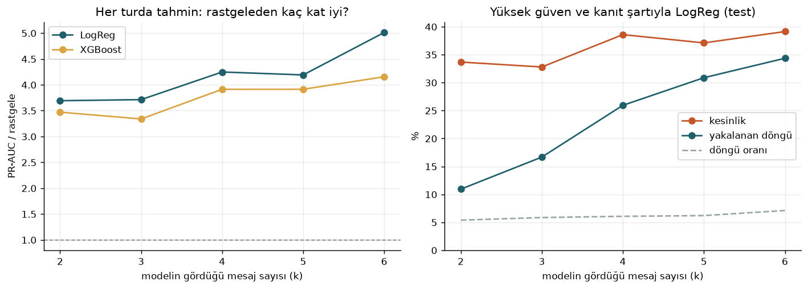
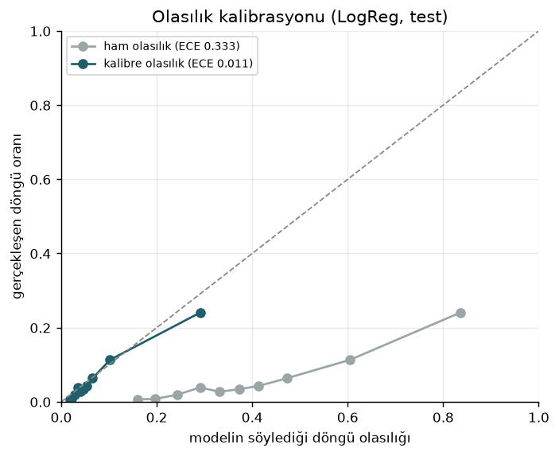
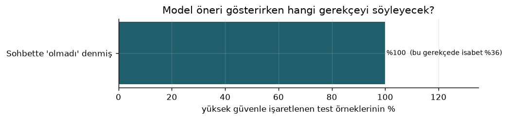

# Bölüm 9: Tur Modeli ve Eklentiye Entegrasyon

**Proje:** Kâfi AI, üretken yapay zeka sohbetlerinde verimsiz döngülerin erken tespiti
**Ekip:** SIC AI 18, Grup 1

Bölüm 8'de seçilen model sohbet başına bir kez, ilk iki mesajdan sonra karar veriyordu. Eklentide ise kullanıcı her mesaj gönderdiğinde elimize yeni bilgi geçiyor: kaç kez "olmadı" dedi, son mesajı bir öncekinin tekrarı mı, sohbet kaçıncı turda. Bu bölüm, modeli her mesajda yeniden çalışacak şekilde kurmayı, olasılıklarını kalibre etmeyi, kullanıcıya gerekçesiyle birlikte öneri göstermeyi ve eklentiye taşımayı anlatıyor. Sayılar `outputs/turn_model_metrics.json` ve `outputs/turn_dataset_*.json` dosyalarından.

Kısaca sonuç:

| | Tur modeli (test kullanıcıları) |
|---|---|
| Ne zaman karar veriyor | Her mesajdan sonra (2. ile 6. tur arası eğitildi; daha uzun sohbetlerde tur sayısı 6'da sabitlenir) |
| Test PR-AUC (tüm turlar) | 0,321 (rastgele 0,098, yani 3,3 kat); ROC-AUC 0,782 |
| 2. turda / 6. turda test PR-AUC | 0,276 (rastgele 0,089) / 0,375 (rastgele 0,113) |
| Olasılık kalibrasyonu (ECE) | 0,304'ten 0,020'ye |
| Yüksek güven eşiğinde | Turların %5,07'si işaretleniyor; kesinlik %44,6, yakalanan döngü %23,0 |
| Kullanıcıya gösterilen | Halkanın tonu; yüksek güvende gerekçe ve somut öneriyle çıkış kartı |
| Eklentide | Çalışıyor, Python ile birebir aynı sonuç |

---

## 1. Neden her turda tahmin?

Bölüm 8'deki bulgu açıktı: döngünün en güçlü işareti kullanıcının "olmadı, hâlâ hata veriyor" gibi onarım ifadeleri. Bu ifadeler çoğunlukla 3. mesajdan sonra geliyor; yalnızca ilk iki mesaja bakan bir model bu bilgiyi hiç göremiyor. Ayrıca döngü oranı tur ilerledikçe artıyor (4.8M eğitim tablosunda 2. turda %9,0, 6. turda %11,9; Bölüm 8, Şekil 25 ile aynı yönde). Kullanıcının yazdığı her yeni mesajla tahmini güncellemek hem daha isabetli hem de ürün açısından daha doğal.

## 2. Veri: her sohbetten birden fazla örnek

`scripts/build_turn_dataset.py`, temizlenmiş her sohbetten k = 2, 3, 4, 5, 6 için birer satır üretiyor. Her satırda öznitelikler ilk k mesajdan, etiket (Bölüm 8'deki ikinci sürüm etiket) k. mesajdan sonrasından geliyor. Etiket için k'dan sonra en az 2 mesaj gerektiği için uzun sohbetler daha çok satır veriyor.

| Kaynak | Sohbet | Satır | Döngü oranı (k = 2 → 6) |
|---|---|---|---|
| WildChat 4.8M (eğitim ve test) | 28.123 | 85.317 | %9,0 → %11,9 |
| WildChat 1M (farklı dönem testi) | 7.965 | 23.522 | %6,6 → %7,7 |
| 4.8M Türkçe | 267 | 740 | %8,2 → %8,6 |
| WildFeedback | 56.718 | 165.770 | %11,5 → %13,5 |

Aynı sohbetin satırları aynı kullanıcıya ait olduğu için eğitim ve test kullanıcıya göre ayrıldı (67.395 eğitim, 17.069 test satırı); bir sohbetin 2. tur satırı eğitimde, 4. tur satırı testte olamıyor. Test kullanıcıları Bölüm 8'dekilerle aynı.

## 3. Öznitelikler: tarayıcıda birebir hesaplanabilen 22 sayı

Bölüm 8'deki modelin bazı öznitelikleri sklearn'ün büyük bir vektörleştiricisine dayanıyordu ve tarayıcıya taşınamıyordu. Tur modelinin öznitelikleri baştan eklentide aynen hesaplanabilecek şekilde seçildi (`src/kafiai/turn_features.py`, eklentide `src/core/turn-features.ts`):

| Grup | Öznitelikler |
|---|---|
| Sohbetin durumu | `turn` (kaçıncı mesaj) |
| İlk ve son mesaj | kelime sayısı (log), satır sayısı, soru işaretiyle bitiyor mu, son mesaj çok kısa mı, rakam oranı |
| Kod | görülen mesajlarda kod işareti var mı |
| Tekrar | son mesajın bir öncekine benzerliği, en yüksek benzerlik, eklenti eşiğini (0,8) geçen çift sayısı, birebir yeniden gönderim sayısı |
| Onarım | son mesajda güçlü onarım ifadesi, şimdiye kadarki güçlü onarım ifadesi sayısı |
| Görev türü | ilk mesajdan, 6 kategori (eklentiyle ortak kurallar) |

En büyük katsayılar: şimdiye kadarki güçlü onarım ifadesi sayısı (0,44), son mesajın uzunluğu (0,27), kod işareti (0,26), ilk mesajın uzunluğu (0,22) ve kod görevi (0,21). Benzer mesaj sayısının katsayısı eksi (−0,20): onarım ifadesi sabitken benzer mesajlar çoğunlukla verimli seri işler (Bölüm 8).

**Onarım kuralları ortak dosyada.** Güçlü onarım ifadeleri Bölüm 8'de Python düzenli ifadeleri olarak yazılmıştı. Düzenli ifadelerdeki kelime sınırı Türkçe harflerde Python ile JavaScript'te farklı davrandığı için kurallar bir JSON dosyasına (`extension/src/data/repair-rules.json`) taşındı: sadeleştirilmiş metinde kelime, kelime başı, kelime grubu ve "ilk kelime" kuralları. Büyük "I" harfi Türkçede "ı", İngilizcede "i" okunduğu için ("HAYIR" ve "I said") metin iki kez, Türkçe karaktersiz yazım için bir kez daha kontrol ediliyor. WildFeedback'teki 150.000 mesajda kurallar eski düzenli ifadelerle %99,9 aynı sonucu verdi; farkların çoğu eski ifadenin hatasıydı.

## 4. Model, kalibrasyon ve eşikler

`scripts/train_turn_model.py` iki modeli kullanıcı bazlı 5 katlı çapraz doğrulamayla karşılaştırdı:

| | CV PR-AUC | Test PR-AUC | Rastgeleye göre | Test ROC-AUC |
|---|---|---|---|---|
| **Logistic Regression** (C = 0,003) | 0,364 | **0,321** | **3,3 kat** | 0,782 |
| XGBoost (derinlik 3, 300 ağaç) | 0,366 | 0,311 | 3,2 kat | 0,785 |

Çapraz doğrulamada iki model başa baş, testte Logistic Regression PR-AUC'de biraz önde. Eklenti için Logistic Regression seçildi: 22 katsayıdan ibaret, tarayıcıda kütüphanesiz çalışıyor ve her tahminin gerekçesi doğrudan okunabiliyor.



*Şekil 26. Solda her turda PR-AUC'nin rastgeleye oranı; sağda yüksek güven eşiğinde ve kanıt şartıyla kesinlik ve yakalanan döngü oranı.*

**Model sohbet ilerledikçe daha iyi görüyor.** PR-AUC 2. turda 0,276'dan 6. turda 0,375'e çıkıyor (rastgelenin 3,1 ve 3,3 katı); yüksek güven eşiğinde yakalanan döngü oranı %13,7'den %36,1'e çıkıyor. Kullanıcı ne kadar çok "olmadı" derse model o kadar emin oluyor; bu da beklenen ve istenen bir davranış.

**Kalibrasyon.** Sınıf ağırlıkları dengelendiği için modelin ham olasılıkları çok şişkindi. Katlar dışı tahminler üzerinde Platt ölçekleme öğrenildi (`olasılık = sigmoid(a × logit(ham) + b)`, a = 0,888, b = −2,165). Test verisinde beklenen kalibrasyon hatası (ECE) 0,304'ten 0,020'ye, Brier skoru 0,181'den 0,078'e indi. Artık modelin söylediği olasılık, gerçekleşen döngü oranına çok yakın.



*Şekil 27. Kalibrasyondan önce ve sonra modelin söylediği olasılık ile gerçekleşen döngü oranı. Kesikli çizgi mükemmel kalibrasyon.*

**İki eşik ve kanıt şartı.** Eşikler test verisine bakılmadan seçildi:

- **Öneri eşiği** (olasılık 0,168): eğitim verisinin katlar dışı tahminlerinde F1'i en yüksek yapan eşik. Bu seviyede halka belirginleşir; uzun sohbet kartı için de gereken işaretlerden biridir.
- **Yüksek güven eşiği** (olasılık 0,30): katlar dışı tahminlerde kesinliği en az %40 olan en düşük eşik 0,21 çıkıyordu; bu eşik WildFeedback seçim örnekleminde yeniden oynatmayla sınandı ve isabetle yakalama arasındaki denge için 0,30 alt sınırı kondu (bu bölümün 10. kısmındaki eşik tablosu; K35). Çıkış kartı bu seviyede açılabiliyor; halka koyulaşıyor.
- **Kanıt şartı:** Yüksek güven için sohbette en az bir güçlü onarım ifadesi görülmüş olmalı. Şart olmadan işaretlenen sohbetlerde gerekçe olarak "son mesajın uzun" gibi kullanıcıya yararı az bir cümle gösteriliyordu.

| Test (17.069 tur, döngü oranı %9,8) | İşaretlenen | Kesinlik | Yakalanan döngü |
|---|---|---|---|
| Öneri eşiği | %13,7 | %32,6 | %45,6 |
| Yüksek güven, şartsız | %6,2 | %39,8 | %24,9 |
| **Yüksek güven + kanıt şartı** | **%5,1** | **%44,6** | **%23,0** |

Yani model kaynaklı çıkış kartı, kullanıcının yazdığı turların yaklaşık %5'inde açılabiliyor ve açıldığında yaklaşık 9 seferden 4'ünde sohbet gerçekten (vekil etikete göre) döngüye giriyor. Rastgele bir kartın isabeti %9,8 olurdu. Gerçek memnuniyetsizliğe karşı isabet yeniden oynatmada ölçüldü: model kartlarının %27,7'si memnuniyetsizlik görülen bir tura denk geliyor (taban %5,0; Bölüm 10).

## 5. Gerekçe ve kullanıcıya dönüt

Logistic Regression'da her özniteliğin tahmine katkısı `katsayı × ölçeklenmiş değer` olarak doğrudan hesaplanabiliyor. Eklenti, olasılığı en çok artıran özniteliği bulup `extension/src/data/model-reasons.json` içindeki karşılığını gösteriyor. Her gerekçe iki parçadan oluşuyor: durumu anlatan bir cümle ve somut bir öneri.

| Öznitelik | Kullanıcıya gösterilen |
|---|---|
| `n_strong_repairs` | "Bu sohbette cevabın işe yaramadığını söylediğin mesajlar var. Model bu noktada yolunu kaybetmiş olabilir. İsteklerini tek bir taslakta toplayıp yeni bir sohbette denemek genelde daha hızlı." |
| `last_strong_repair` | "Son mesajında bir önceki cevabın işe yaramadığını söyledin. Neyin yanlış olduğunu ve tam olarak ne beklediğini tek cümleyle yazmak, aynı cevabın tekrar gelmesini çoğu zaman önlüyor." |
| `has_code`, `task_kod` | Hata mesajının tamamını, beklenen davranışı ve denenenleri birlikte paylaşma; sorunu küçük bir parçaya indirme önerisi |
| `n_exact`, `last_sim` | Aynı mesajı tekrar göndermek yerine önceki cevapta neyin eksik kaldığını ekleme önerisi |
| `turn` | Uzun sohbetlerde modellerin baştaki ayrıntıları kaçırabildiği, taze bir sohbetle devam edilebileceği |



*Şekil 28. Yüksek güvenle işaretlenen test örneklerinde gösterilecek gerekçenin dağılımı ve her gerekçede isabet.*

Kanıt şartının doğal sonucu olarak yüksek güvenle işaretlenen test turlarının tamamında en güçlü gerekçe "sohbette olmadı denmiş" (`n_strong_repairs`); bu kartlarda kesinlik %44,6. Kartta bir de **"Yerinde değildi"** düğmesi var; kullanıcının bu geri bildirimi yalnızca sayı olarak tutuluyor (`card_action yerinde_degil`).

## 6. Dış testler

| Dış test | Tur satırı | Döngü oranı | PR-AUC | Rastgeleye göre | ECE | Yüksek güven kesinliği |
|---|---|---|---|---|---|---|
| WildChat 1M (farklı dönem) | 15.822 | %7,0 | 0,309 | 4,4 kat | 0,022 | %45,7 |
| Türkçe (4.8M) | 740 | %8,4 | 0,258 | 3,1 kat | 0,019 | %39,4 |
| WildFeedback, bizim etiket | 149.965 | %12,3 | 0,324 | 2,6 kat | 0,017 | %46,4 |
| WildFeedback, gerçek memnuniyetsizlik (DSAT) | 149.965 | %13,5 | 0,250 | 1,9 kat | 0,040 | %37,6 |

Kalibrasyon eğitimde görülmeyen veri setlerinde de tutuyor (ECE 0,017 ile 0,040 arası). Türkçede test seti küçük (740 satır, 62 döngü). Platformlara göre sınama (ShareChat ve LMSYS) Bölüm 5, K25'te: model beş sitenin hepsinde açık kalma ölçütlerini geçiyor.

## 7. Eklentiye entegrasyon

| Dosya | Görevi |
|---|---|
| `extension/src/data/turn-model.json` | Model: öznitelik listesi, ortalama, ölçek, katsayılar, Platt değerleri, eşikler, kanıt şartı. `train_turn_model.py` üretir, elle değiştirilmez (1.739 bayt). |
| `extension/src/data/repair-rules.json` | Güçlü onarım kuralları; Python ile ortak |
| `extension/src/data/model-reasons.json` | Gerekçe ve öneri metinleri; özür döngüsü ve düzeltme alınmadı kartlarının metinleri de burada |
| `extension/src/core/strong-repair.ts`, `turn-features.ts`, `turn-model.ts` | Öznitelik, olasılık, seviye ve gerekçe hesabı |
| `extension/src/core/ring.ts` | Halka seviyesi: modelin öneri ve yüksek güven seviyeleri sohbet sinyalleriyle birleşir |
| `extension/src/core/exit-card-policy.ts` | Çıkış kartı dört yoldan açılabiliyor: modelin yüksek güvenli tahmini, özür döngüsü, düzeltme alınmadı ve görev normunu aşan uzun sohbet. Bekleme süresi hepsinde aynı; bir turda tek müdahale (K39). |
| `extension/src/ui/exit-card.ts` | Model kaynaklı kartta gerekçe, öneri, "Yerinde değildi" düğmesi ve modelin cihazda çalıştığını söyleyen kısa not |
| `extension/src/content/index.ts` | Kullanıcı mesajları yalnızca bellekte tutulur; her gönderimde tahmin güncellenir. Günlüğe yalnızca olasılık, seviye ve gerekçe anahtarı yazılır, mesaj metni yazılmaz. |

**Python ile birebir aynı sonuç.** `scripts/make_turn_parity_fixture.py` elle yazılmış sohbetlerden 33 tur ve 35 onarım örneği üretiyor (gerçek kullanıcı mesajı yok). Python testleri (`tests/test_turn_model.py`) ve eklenti testleri (`src/core/turn-model.parity.test.ts`) aynı dosyayı okuyor: 22 özniteliğin her biri 10⁻⁹ hassasiyetle, olasılık, seviye ve gerekçeler birebir aynı çıkmak zorunda.

**"Yalnızca say" modu.** Öneriler kapalıyken model yine çalışıyor ama hiçbir şey göstermiyor; şerit ya da kart gösterilecek olsaydı bu `gizlendi_sayim` olarak sayılıyor. Böylece kullanıcı hiçbir şey görmeden eklentinin kaç kez devreye gireceği ölçülebiliyor.

## 8. Sınırlar

- Etiket kurallardan gelen bir vekil etiket; elle doğrulanmış bir set yok (K02). Model gerçek memnuniyetsizliği (DSAT) rastgeleden 1,9 kat iyi ayırıyor; bu mütevazı bir oran. Bu yüzden kart engellemiyor ve en isabetli kartlar modelden değil kurallardan geliyor (özür döngüsü %45,4, düzeltme alınmadı %50,0).
- Yüksek güven eşiği isabetle yakalama arasında bir denge; 0,30 seçim örnekleminde seçildi.
- Model yalnızca kullanıcı mesajlarına bakıyor; asistanın cevaplarını görmüyor. Cevap tarafı bilgisi (özür, aynı cevabın tekrarı, teklif sorusu) modele değil ayrı kurallara giriyor ve yalnızca bellekte okunuyor.
- Model 6. turdan sonrasını ayrıca öğrenmedi; daha uzun sohbetlerde tur sayısı 6'da sabitleniyor. Modelin daha uzun sohbetlere uzatılması ve gerçek memnuniyetsizlik etiketiyle yeniden eğitilmesi sonraki çalışma (K50).
- Türkçe test seti küçük.

## 9. Çalıştırma

```bash
python scripts/build_turn_dataset.py --source 48m
python scripts/build_turn_dataset.py --source 48m_turkish
python scripts/build_turn_dataset.py --source 1m
python scripts/build_turn_dataset.py --source wildfeedback   # en uzun süren adım
python scripts/train_turn_model.py                           # Şekil 26-28, turn-model.json
python scripts/make_turn_parity_fixture.py                   # model değiştiyse mutlaka
python -m pytest tests
cd extension && npm run check
```

Sayılar: `outputs/turn_dataset_*.json`, `outputs/turn_model_metrics.json`.

---

## 10. Kuralların veriyle inceltilmesi (Kasım 2026)

Elle doğrulama aşamasından önce karar zincirinin kuralları WildFeedback'teki gerçek memnuniyetsizlik işaretleriyle parça parça yeniden ölçüldü (Bölüm 5, K35). Etiket onarım kuralına dayandığı için veri tabloları yeniden kuruldu ve model yeniden eğitildi. Bu bölümün üstündeki sayılar yeniden eğitilmiş modelindir; aşağıdaki tablo değişikliğin önce ve sonrasını gösteriyor.

Yöntem: her kural değişikliği verinin rastgele bir yarısında seçildi, öbür yarısında doğrulandı. Kart kuralı ve eşik, rapor örnekleminden (20.000 sohbet, tohum 42) ayrık 20.000 sohbette seçildi.

| Değişiklik | Dayanak | Dosya |
|---|---|---|
| "still", "again", "hala", "yine" yalnızca 60 kelimeden kısa mesajlarda onarım sayılır | Kısa mesajda 5 ile 11 kat, 60 kelimenin üstünde 0,9 kat | `repair-rules.json` → `limited_words` |
| "same thing" listeden çıktı | 1,45 kat; 2 kat ölçütünün altında | `repair-rules.json` |
| Yeni onarım ifadeleri: hata adları ("typeerror", "traceback", "invalid", "undefined"), "not defined", "fix it", "has no" her uzunlukta; "is not", "does not", "didn't", "are you sure", "nothing", "cannot", "expected", "redo" yalnızca kısa mesajda | Kuralın yakalamadığı mesajlarda iki yarıda da en az 3 kat | `repair-rules.json` |
| Görev türü kuralı büyük harfli kısaltmaları tanır ("API", "CLI"); Türkçe soru ve kod kalıpları | Türkçe ilk mesajlarda "diğer" payı %55,0'dan %45,8'e | `task-rules.json`, `tasks.ts`, `tasks.py` |
| 16 ile 40 kelime arası bir mesajın birebir yeniden gönderimi varyasyon sayılmaz | Bu grupta memnuniyetsizlik %27,0; kısa varyasyon isteklerinde %4,5, 40 kelime üstünde %9,3 | `repeat-rules.json` → `variation` |
| Uzun sohbet kartı için iki işaret birlikte: yakın benzer mesaj ve modelin öneri seviyesi | Tek işaretle bu yolun isabeti %9, ikisiyle %26 | `exit-card-policy.ts` |
| Yüksek güven eşiğine 0,30 alt sınırı | Aşağıdaki denge tablosu | `train_turn_model.py` → `HIGH_MIN_PROBABILITY` |

Denenip alınmayan: model kartı için "en az 3. tur ya da iki onarım ifadesi" şartı. Yakalamayı %40,8'den %25,8'e düşürdü, isabeti artırmadı (%24,4 → %23,9).

Eşik seçimi (seçim örneklemi; kart 100 sohbette / isabet / tekrarlayan memnuniyetsizliği yakalama):

| Yüksek güven eşiği | Kart | İsabet | Yakalama |
|---|---|---|---|
| 0,21 (yalnızca kesinlik hedefi) | 25,8 | %26,5 | %39,8 |
| **0,30 (seçilen)** | **19,0** | **%31,0** | **%29,7** |
| 0,35 | 17,0 | %32,5 | %25,2 |
| 0,40 | 15,0 | %34,3 | %21,1 |
| 0,50 | 12,5 | %38,4 | %16,8 |

Önce ve sonra (rapor örneklemi ve test kullanıcıları):

| Ölçüt | Önce | Sonra |
|---|---|---|
| Onarım kuralının yakaladığı memnuniyetsiz mesaj payı (WildFeedback, 420 bin mesaj) | %28,9 | %42 |
| Kuralın işaretlediği mesajlarda memnuniyetsizlik | %25,3 | %28,9 |
| Etiketin memnuniyetsizlik katı (kontrol yarısı) | 2,87 | 3,05 |
| 4.8M'de döngü oranı (etiket genişledi) | %6,7 | %9,0 |
| Test PR-AUC / rastgele | 0,251 / 0,066 | 0,321 / 0,098 |
| Test ROC-AUC | 0,775 | 0,782 |
| Yüksek güven: kesinlik / yakalama (vekil etiket) | %37,6 / %21,2 | %44,6 / %23,0 |
| Modelin gerçek memnuniyetsizliği ayırması (WildFeedback, PR-AUC / ROC-AUC) | 0,218 / 0,612 | 0,250 / 0,638 |
| Yeniden oynatma: çıkış kartı, 100 sohbette / isabet | 21,6 / %24,2 | 18,9 / %31,3 |
| Yeniden oynatma: tekrarlayan memnuniyetsizlikte yakalama | %20,9 | %28,7 |
| Yeniden oynatma: koyu halka, tur payı / isabet | %8,3 / %26,1 | %9,3 / %29,2 |
| Yeniden oynatma: benzer mesaj şeridi, 100 sohbette / isabet | 14,3 / %16,6 | 14,7 / %17,0 |
| EmoWOZ (insan etiketi, farklı alan): onarım kuralı kesinlik / yakalama | %8,3 / %10,8 | %8,9 / %12,5 |
| Platform sınaması: yüksek güven kesinliği, ChatGPT / Gemini / Claude | %46,0 / %47,3 / %46,6 | %50,6 / %50,0 / %45,8 |

Sonraki kararlarla (K37 ile K48) şerit ve kart kuralları yeniden değişti; bugünkü yeniden oynatma sonuçları [Bölüm 10, 6.3](10_deployment.md)'te. Model bu kararlardan etkilenmedi.

**Okurken.** Vekil etikete göre ölçülen sayılar (PR-AUC, döngü oranı) etiket de değiştiği için doğrudan karşılaştırılamaz; rastgeleye göre kat 3,8'den 3,3'e indi, çünkü etiket artık daha sık. Karşılaştırılabilir olanlar gerçek memnuniyetsizliğe karşı ölçülen satırlardır: daha az kart, daha yüksek isabet, daha yüksek yakalama. Kartların yaklaşık üçte ikisi hâlâ memnuniyetsizlik görülmeyen bir tura denk geliyor; bu yüzden hiçbir uyarı engellemez. Platform sınamasında beş platformun hepsinde model açık kalıyor. Türkçe onarım kelimeleri WildFeedback'te neredeyse hiç geçmediği için İngilizce karşılıklarına benzetilerek sınırlandı; Türkçe karaktersiz yazım ve doğrulanmış ifadelerin Türkçe karşılıkları sonradan eklendi (K36).
