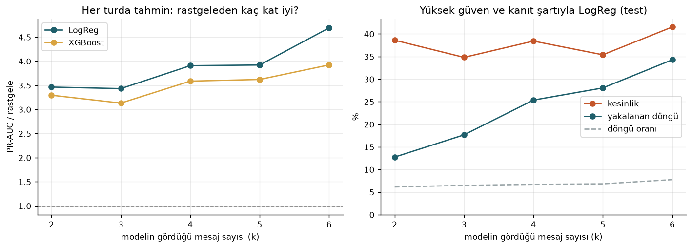
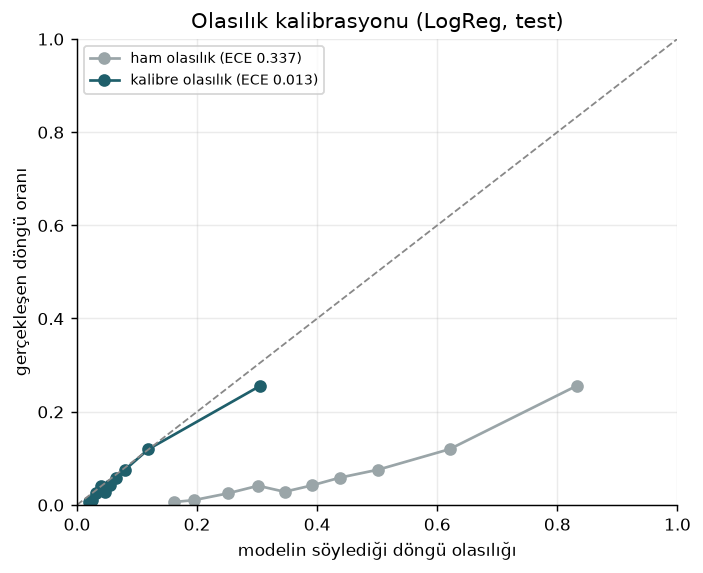
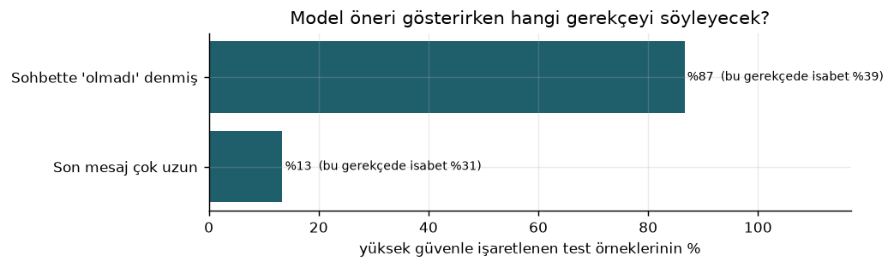

# Bölüm 9: Tur Modeli ve Eklentiye Entegrasyon

**Proje:** KafiAI, üretken yapay zeka sohbetlerinde verimsiz döngülerin erken tespiti
**Ekip:** SIC AI 18, Grup 1

Bölüm 8'de seçilen model sohbet başına bir kez, ilk iki mesajdan sonra karar veriyordu. Eklentide ise kullanıcı her mesaj gönderdiğinde elimize yeni bilgi geçiyor: kaç kez "olmadı" dedi, son mesajı bir öncekinin tekrarı mı, sohbet kaçıncı turda. Bu bölüm, modeli her mesajda yeniden çalışacak şekilde yeniden kurmayı, olasılıklarını kalibre etmeyi, kullanıcıya gerekçesiyle birlikte öneri göstermeyi ve eklentiye taşımayı anlatıyor.

Kısaca sonuç:

| | Bölüm 8 modeli | Tur modeli |
|---|---|---|
| Ne zaman karar veriyor | Yalnızca 2. mesajdan sonra | Her mesajdan sonra (2. ile 6. tur arası eğitildi) |
| 2. turda test PR-AUC (aynı test kullanıcıları) | 0,199 | 0,213 |
| 6. turda test PR-AUC | | 0,364 (rastgelenin 4,7 katı) |
| Olasılık kalibrasyonu (ECE) | Kalibre değil | 0,337'den 0,013'e |
| Kullanıcıya gösterilen | Yok | Gerekçe ve somut öneri |
| Eklentide | Yok | Çalışıyor, Python ile birebir aynı sonuç |

---

## 1. Neden her turda tahmin?

Bölüm 8'deki bulgu açıktı: döngünün en güçlü işareti kullanıcının "olmadı, hâlâ hata veriyor" gibi onarım ifadeleri. Bu ifadeler çoğunlukla 3. mesajdan sonra geliyor; yalnızca ilk iki mesaja bakan bir model bu bilgiyi hiç göremiyor. Ayrıca döngü oranı tur ilerledikçe artıyor (4.8M eğitim tablosunda 2. turda %6,8, 6. turda %9,0; Bölüm 8, Şekil 25 ile aynı yönde). Kullanıcının yazdığı her yeni mesajla tahmini güncellemek hem daha isabetli hem de ürün açısından daha doğal.

## 2. Veri: her sohbetten birden fazla örnek

`scripts/build_turn_dataset.py`, temizlenmiş her sohbetten k = 2, 3, 4, 5, 6 için birer satır üretiyor. Her satırda öznitelikler ilk k mesajdan, etiket (Bölüm 8'deki ikinci sürüm etiket) k. mesajdan sonrasından geliyor. Etiket için k'dan sonra en az 2 mesaj gerektiği için uzun sohbetler daha çok satır veriyor.

| Kaynak | Sohbet | Satır | Döngü oranı (k = 2 → 6) |
|---|---|---|---|
| WildChat 4.8M (eğitim ve test) | 28.123 | 85.317 | %6,8 → %9,0 |
| WildChat 1M (farklı dönem testi) | 7.965 | 23.522 | %4,7 → %5,2 |
| 4.8M Türkçe | 267 | 740 | %9,4 → %11,4 |
| WildFeedback | 56.718 | 165.770 | %8,4 → %9,1 |

Aynı sohbetin satırları aynı kullanıcıya ait olduğu için eğitim ve test yine kullanıcıya göre ayrıldı; bir sohbetin 2. tur satırı eğitimde, 4. tur satırı testte olamıyor. Test kullanıcıları Bölüm 8'dekilerle aynı, bu yüzden iki model 2. turda doğrudan karşılaştırılabiliyor.

## 3. Öznitelikler: tarayıcıda birebir hesaplanabilen 22 sayı

Bölüm 8'deki modelin bazı öznitelikleri sklearn'ün büyük bir vektörleştiricisine dayanıyordu ve tarayıcıya taşınamıyordu. Tur modelinin öznitelikleri baştan eklentide aynen hesaplanabilecek şekilde seçildi (`src/kafiai/turn_features.py`, eklentide `src/core/turn-features.ts`):

| Grup | Öznitelikler |
|---|---|
| Sohbetin durumu | `turn` (kaçıncı mesaj) |
| İlk ve son mesaj | kelime sayısı (log), satır sayısı, soru işaretiyle bitiyor mu, son mesaj çok kısa mı, rakam oranı |
| Kod | görülen mesajlarda kod işareti var mı |
| Tekrar | son mesajın bir öncekine benzerliği, en yüksek benzerlik, eklenti eşiğini (0,8) geçen çift sayısı, birebir yeniden gönderim sayısı |
| Onarım | son mesajda güçlü onarım ifadesi, şimdiye kadarki güçlü onarım ifadesi sayısı |
| Görev türü | ilk mesajdan, 6 kategori (eklentiyle ortak kurallar) |

**Onarım kuralları ortak dosyaya taşındı.** Güçlü onarım ifadeleri Bölüm 8'de Python düzenli ifadeleri olarak yazılmıştı. Düzenli ifadelerdeki kelime sınırı Türkçe harflerde Python ile JavaScript'te farklı davrandığı için kurallar, görev türü kurallarıyla aynı biçimde bir JSON dosyasına (`extension/src/data/repair-rules.json`) taşındı: sadeleştirilmiş metinde kelime, kelime başı, kelime grubu ve "ilk kelime" kuralları. Büyük "I" harfi Türkçede "ı", İngilizcede "i" okunduğu için ("HAYIR" ve "I said") metin iki kez kontrol ediliyor. WildFeedback'teki 150.000 mesajda yeni kurallar eski düzenli ifadelerle %99,9 aynı sonucu verdi; farkların çoğu eski ifadenin hatasıydı ("not what is said" gibi bir cümleyi yanlışlıkla onarım saymak).

## 4. Model, kalibrasyon ve eşikler

`scripts/train_turn_model.py` iki modeli kullanıcı bazlı 5 katlı çapraz doğrulamayla karşılaştırdı:

| | CV PR-AUC | Test PR-AUC | Rastgeleye göre | Test ROC-AUC |
|---|---|---|---|---|
| **Logistic Regression** (C = 0,003) | 0,289 | **0,251** | **3,8 kat** | **0,775** |
| XGBoost (derinlik 3, 300 ağaç) | 0,293 | 0,226 | 3,4 kat | 0,773 |

Çapraz doğrulamada iki model başa baş, testte Logistic Regression önde. Eklenti için Logistic Regression seçildi: 22 katsayıdan ibaret, tarayıcıda kütüphanesiz çalışıyor ve her tahminin gerekçesi doğrudan okunabiliyor.



*Şekil 26. Solda her turda PR-AUC'nin rastgeleye oranı; sağda yüksek güven eşiğinde ve kanıt şartıyla kesinlik ve yakalanan döngü oranı.*

**Model sohbet ilerledikçe daha iyi görüyor.** 2. turda rastgelenin 3,5 katı olan başarı 6. turda 4,7 katına çıkıyor; yüksek güven eşiğinde yakalanan döngü oranı %13'ten %34'e çıkıyor. Kullanıcı ne kadar çok "olmadı" derse model o kadar emin oluyor; bu da beklenen ve istenen bir davranış.

**Kalibrasyon.** Sınıf ağırlıkları dengelendiği için modelin ham olasılıkları çok şişkindi: model "%60 risk" dediğinde gerçekte sohbetlerin yaklaşık %12'si döngüye giriyordu. Katlar dışı tahminler üzerinde Platt ölçekleme öğrenildi (`olasılık = sigmoid(a × logit(ham) + b)`, a = 0,88, b = −2,45). Test verisinde beklenen kalibrasyon hatası (ECE) 0,337'den 0,013'e, Brier skoru 0,187'den 0,056'ya indi. Artık modelin söylediği olasılık, gerçekleşen döngü oranına çok yakın.



*Şekil 27. Kalibrasyondan önce ve sonra modelin söylediği olasılık ile gerçekleşen döngü oranı. Kesikli çizgi mükemmel kalibrasyon.*

**İki eşik ve kanıt şartı.** Eşikler test verisine bakılmadan, eğitim verisinin katlar dışı tahminlerinden seçildi:

- **Öneri eşiği** (olasılık 0,143): F1'i en yüksek yapan eşik. Eklenti bu seviyede kendiliğinden bir şey göstermiyor; ileride kullanıcı isterse görebileceği bir bilgi olarak duruyor.
- **Yüksek güven eşiği** (olasılık 0,263): kesinliği en az %40 olan en düşük eşik. Çıkış kartı bu seviyede açılabiliyor.
- **Kanıt şartı:** Yüksek güven için sohbette en az bir güçlü onarım ifadesi görülmüş olmalı. İlk eğitimde bu şart yoktu ve onarım ifadesi olmadan işaretlenen sohbetlerde isabet yalnızca %12,5 çıktı; gerekçe olarak da "son mesajın uzun" gibi kullanıcıya yararı az bir cümle gösteriliyordu. Şartla test kesinliği %33'ten %38'e çıktı, yakalanan döngü oranı ise yalnızca %22,8'den %21,2'ye indi.

| Test (17.069 tur, döngü oranı %6,6) | İşaretlenen | Kesinlik | Yakalanan döngü |
|---|---|---|---|
| Öneri eşiği | %11,4 | %23,8 | %41,2 |
| Yüksek güven, şartsız | %4,6 | %33,0 | %22,8 |
| **Yüksek güven + kanıt şartı** | **%3,7** | **%37,6** | **%21,2** |

Yani çıkış kartı, kullanıcının yazdığı turların yaklaşık %4'ünde açılıyor ve açıldığında yaklaşık 8 seferden 3'ünde sohbet gerçekten döngüye giriyor. Rastgele bir kartın isabeti %6,6 olurdu.

## 5. Gerekçe ve kullanıcıya dönüt

Logistic Regression'da her özniteliğin tahmine katkısı `katsayı × ölçeklenmiş değer` olarak doğrudan hesaplanabiliyor. Eklenti, olasılığı en çok artıran özniteliği bulup `extension/src/data/model-reasons.json` içindeki karşılığını gösteriyor. Her gerekçe iki parçadan oluşuyor: durumu anlatan bir cümle ve somut bir öneri.

| Öznitelik | Kullanıcıya gösterilen |
|---|---|
| `n_strong_repairs` | "Bu sohbette cevabın işe yaramadığını söylediğin mesajlar var. Model bu noktada yolunu kaybetmiş olabilir. İsteklerini tek bir taslakta toplayıp yeni bir sohbette denemek genelde daha hızlı." |
| `last_strong_repair` | "Son mesajında bir önceki cevabın işe yaramadığını söyledin. Neyin yanlış olduğunu ve tam olarak ne beklediğini tek cümleyle yazmak, aynı cevabın tekrar gelmesini çoğu zaman önlüyor." |
| `has_code`, `task_kod` | Hata mesajının tamamını, beklenen davranışı ve denenenleri birlikte paylaşma; sorunu küçük bir parçaya indirme önerisi |
| `n_exact`, `last_sim` | Aynı mesajı tekrar göndermek yerine önceki cevapta neyin eksik kaldığını ekleme önerisi |
| `turn` | Uzun sohbetlerde modellerin baştaki ayrıntıları kaçırabildiği, taze bir sohbetle devam edilebileceği |



*Şekil 28. Yüksek güvenle işaretlenen test örneklerinde gösterilecek gerekçenin dağılımı ve her gerekçede isabet.*

Kartların %87'sinde gerekçe "sohbette olmadı denmiş" oluyor ve bu kartlarda isabet %39. Geri kalanında gerekçe "son mesaj çok uzun"; isabet %31. Kartta bir de **"Yerinde değildi"** düğmesi var: kullanıcının bu geri bildirimi yalnızca sayı olarak tutuluyor (`modelNotRelevant`) ve pilotta modelin gerçek kullanımdaki isabetini ölçmemizi sağlayacak.

## 6. Dış testler

| Dış test | Tur satırı | Döngü oranı | PR-AUC | Rastgeleye göre | ECE | Yüksek güven kesinliği |
|---|---|---|---|---|---|---|
| WildChat 1M (farklı dönem) | 15.822 | %4,8 | 0,227 | 4,8 kat | 0,019 | %35,7 |
| Türkçe (4.8M) | 740 | %10,4 | 0,257 | 2,5 kat | 0,035 | %31,0 |
| WildFeedback, bizim etiket | 149.965 | %8,6 | 0,245 | 2,8 kat | 0,006 | %37,0 |
| WildFeedback, DSAT etiketi | 149.965 | %13,5 | 0,218 | 1,6 kat | 0,057 | %31,7 |

Kalibrasyon eğitimde görülmeyen veri setlerinde de tutuyor (ECE 0,006 ile 0,057 arası). Türkçede başarı İngilizceye göre düşük ve test seti küçük (740 satır, 77 döngü); Türkçe onarım ifadelerinin elle doğrulanması hâlâ açık iş.

## 7. Eklentiye entegrasyon

| Dosya | Görevi |
|---|---|
| `extension/src/data/turn-model.json` | Model: öznitelik listesi, ortalama, ölçek, katsayılar, Platt değerleri, eşikler, kanıt şartı. `train_turn_model.py` üretir, elle değiştirilmez. |
| `extension/src/data/repair-rules.json` | Güçlü onarım kuralları; Python ile ortak |
| `extension/src/data/model-reasons.json` | Gerekçe ve öneri metinleri |
| `extension/src/core/strong-repair.ts`, `turn-features.ts`, `turn-model.ts` | Öznitelik, olasılık, seviye ve gerekçe hesabı |
| `extension/src/core/exit-card-policy.ts` | Çıkış kartı artık iki yoldan açılabiliyor: görev normu (Bölüm 5, K14) ya da modelin yüksek güvenli tahmini. Bekleme süresi ikisinde de aynı. |
| `extension/src/ui/exit-card.ts` | Model kaynaklı kartta gerekçe, öneri, "Yerinde değildi" düğmesi ve modelin cihazda çalıştığını söyleyen kısa not |
| `extension/src/content/index.ts` | Kullanıcı mesajları yalnızca bellekte tutulur; her gönderimde tahmin güncellenir. Günlüğe yalnızca olasılık, seviye ve gerekçe anahtarı yazılır, mesaj metni yazılmaz. |

**Python ile birebir aynı sonuç.** `scripts/make_turn_parity_fixture.py` elle yazılmış 12 sohbetten 33 tur ve 27 onarım örneği üretiyor (gerçek kullanıcı mesajı yok). Python testleri (`tests/test_turn_model.py`) ve eklenti testleri (`src/core/turn-model.parity.test.ts`) aynı dosyayı okuyor: 22 özniteliğin her biri 10⁻⁹ hassasiyetle, olasılık, seviye ve gerekçeler birebir aynı çıkmak zorunda.

**"Yalnızca say" modu.** Öneriler kapalıyken model yine çalışıyor ama hiçbir şey göstermiyor; kart gösterilecek olsaydı `modelCardWouldShow` sayacı artıyor. Pilotta ilk hafta bu modda kalınarak modelin kaç kez devreye gireceği, kullanıcı hiçbir şey görmeden ölçülecek.

## 8. Sınırlar

- Etiket hâlâ kurallardan geliyor; model gerçek memnuniyetsizliği (DSAT) rastgeleden 1,6 kat iyi tahmin ediyor, bu da mütevazı bir oran.
- Yüksek güven eşiği eğitimde %40 kesinlik için seçildi, testte %37,6 çıktı.
- Model yalnızca kullanıcı mesajlarına bakıyor; asistanın cevaplarını görmüyor. Bu bilerek verilmiş bir karar (gizlilik ve basitlik), ama cevabın kalitesine dair bilgiyi de dışarıda bırakıyor.
- Türkçe onarım ifadeleri ve Türkçe test seti küçük.

## 9. Çalıştırma

```bash
python scripts/build_turn_dataset.py --source 48m
python scripts/build_turn_dataset.py --source 48m_turkish
python scripts/build_turn_dataset.py --source 1m
python scripts/build_turn_dataset.py --source wildfeedback   # en uzun süren adım
python scripts/train_turn_model.py                           # Şekil 26-28, turn-model.json
python scripts/make_turn_parity_fixture.py                   # model değiştiyse mutlaka
python -m pytest tests
cd extension && npm test && npm run build
```

Sayılar: `outputs/turn_dataset_*.json`, `outputs/turn_model_metrics.json`.
